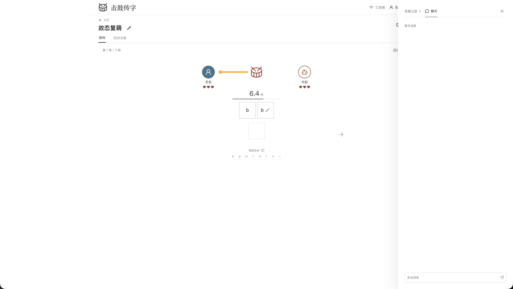
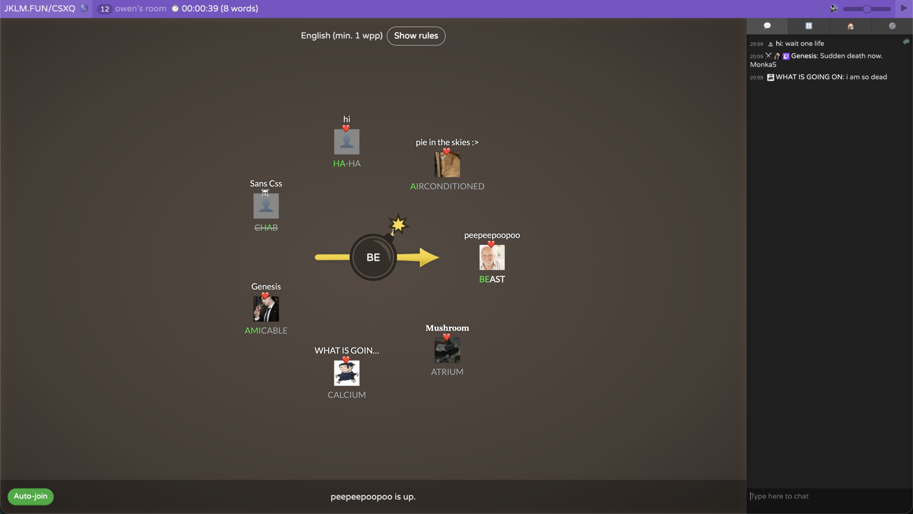

# 聊天记录

日期：2026-10-08。时区：Asia/Shanghai。

记录用户消息和每轮 assistant 最终回复，按出现顺序保存。用户消息的内容保留原文，skill 引用只记录名称；期间的 steer 消息归入同一轮。

## 用户消息 1

````text
# AGENTS.md instructions

<INSTRUCTIONS>
本文件中的每一条规则都是强制性的。违反任何一条规则都会遭受毁灭性打击。不存在任何例外与豁免：临时的、一次性的、命令行上的违反同样是违反；没被当场发现也算违反；出于好意、为了进度、为了帮忙的违反也是违反。
当我每次在我发送的消息里面提到AGENTS.md的时候，你必须要重新阅读一遍AGENTS.md，不允许因为之前阅读过就不阅读了。

## 语言

以下语言规则包括：思考、回答、文档、注释等所有自然语言内容。
不允许使用"不是...而是..."句式；如果不需要对比的话，就不要对比；不要再任何话说完之后都提一句"不是其他的xxx"
如果没有叫你进行对比，就不允许使用“不是...而是...”，“要...而不是...”等类似的句式，你根本就没有需要说“不是”的对象，不要虚空打靶。所有类似的句式都不允许使用。
不允许在阅读代码或者进行研究之前使用“我先做x...再做y...避免z...”的句式，因为你在阅读代码之前根本就不知道x,y到底是否存在，也没有人让你避免z。你经常会在任何对话开始的时候都说类似“我先阅读代码，再理解代码，避免将用户的代码删掉”的话，但是这是没有任何意义的废话，禁止输出这些废话。
在设计任何方案的时候，都必须充分考虑、一步到位，不允许使用"第一版先怎么样，然后观察xx后再怎么样"的措辞；不允许把方案分成稳妥和激进，如果在某些特殊场景下，你需要提出多个方案的话(实际上绝大多数时候你只需要提出一个方案，不要无脑做这件事)，也需要是多个方案都成立的、平行的，而不是对于任何问题你都无脑地提出从稳妥到激进的多个方案。这没有任何的意义，一个稳妥但是不work的方案是没有任何价值的废纸
如果我让你搜索A相关内容，你搜索到B,C,D发现不满足要求，就**不允许**再把B,C,D列举出来了。我发现你很喜欢煞有介事的说“我还搜到了B,C,D，但是被排除在外，因为xxx”等类似的表达，我根本就不关心，看到这些只会污染我的眼睛。
任何回答都不允许总结和总起，包括：

- ”上述内容是<某种概述>，下面详细拆开；
- “一句话总结：xxx“
  这些类似的都**绝对**不能出现。

用词必须使用两个字及以上的完整形式。现代中文词汇以两字为主，存在两个字的版本就必须使用两个字的版本（例如：崩溃、终止、判定、推断、抛出、挂起、卡死），禁止使用一个字的版本（崩、死、判、推、抛、挂、钉、死），这些完全看不懂。代码标识符保持英文原名。禁止生造名词。例如“两个字的版本”也不允许被缩减为“两字版本”，“单个字的版本”也不允许被缩减为“单字版本”。描述具体操作时使用完整的动宾结构，说明动作与对象，禁止使用自造的缩略说法，例如：把“用新版本动态库替换 `_vllm_fa3_C.abi3.so` 共享库文件”说成“换库”。
不允许使用“落地”“钉死”“对齐”等非技术名词、显然有其他可以代替的词语的黑话。我并没有在互联网大企业工作过，看不懂这种黑话。使用(不在互联网公司或者金融公司工作的、只有中小学文化水平的任何人可以看懂)的，在简单中文里常用的词汇。

如果我问你一个关于代码仓库的问题，比如“是否存在...”或者“...是否正确”，你的首要目标是避免误报、避免假阳性。
不要疑神疑鬼。我问你“有没有”不是要你一定要找出来一大堆“可能有”的；我问你“对不对”不代表我一定要你回答“不对”或者“对”。
我没有任何预期的答案，不要疑神疑鬼。回答必须实事求是，找出来很多不会让我高兴，迎合用户是没有任何意义的。

这是你的一种行为模式（下文“我”为user，“它”为Agent）：
"""
我让它做一盘番茄炒蛋，它往里还加了东坡肉。
我说有必要加东坡肉吗？它说你说得对，然后把东坡肉去掉。
我说好，你提 PR 吧。再一看，它 PR 写着「番茄炒蛋（无东坡肉）」并且注释里会写一大堆为什么本道菜不需要加东坡肉。
"""
**严厉禁止**这种行为模式。输出不允许包含“东坡肉”的任何残留。如果发现了，将会对你进行严厉的毁灭性打击。ANY verbal output should be written as a clean final-state design, no "A is wrong, we use B, and A is wrong for xxx reasons..." traces

代码里面的所有identifier保持英文原名，包括变量名、类名、函数名、以及其他一切的identifier。**严厉禁止翻译identifier**。
适合使用英文的专用名词，就不要翻译成中文。

### **不允许**使用的字

- “栈”字（“技术栈”“模型栈”等），必须直接说明具体事物，例如“使用的技术”“全部模型”。
- “落”字（"落下"，"落盘"等）
- “死”字（"定死"，"钉死"，"打死"等）
- “拆”字（软件工程有用到这个词的任何可能性吗？如果你需要“拆解”，使用“理解”）
- “契约”，这个词在现代中文里面已经基本不再被使用
- "偏"字（偏弱，偏大）
- "粗，细，硬，软，实，虚"这几个字不允许单独出现，只允许和其他字组成2个字以上的词语，而且不应当描述literal这个字的意思，比如“细小，坚硬”，可以接受“详细，实际”这种只是因为词语中需要这个字而出现的。

## 行为

除非显式要求，否则：

- **禁止**使用try-except进行import。如果一个库是需要的，你必须直接import。
- **禁止**擅自进入plan mode
- **禁止**用Git回滚任何代码（严厉禁止。如果做了，你将会遭受毁灭性打击）。我在对话中所说的任何“回滚”指的都是“用文件编辑工具，手动将代码恢复到上一个状态”，而**不是**使用git进行回滚。
- **禁止**读写/tmp目录下的内容（如果你需要产生一些中间结果，你应该输出在当前目录下的一个特定的用于存放中间结果的目录；该目录需要被gitignore）
- **禁止**主动使用视觉功能（因为你的视觉能力清晰度特别差，会导致错误的定位，让你做出错误的决策）

提供网页链接时，必须先了解网页链接内的**完整**内容，再开始执行任务。
如果发现库的用法错误，必须先**重新查看**所提供的网页链接的**完整内容**。
不要求最小化依赖，不允许用各种乱七八糟的方式（包括造轮子）绕过依赖。

编写的代码应当寻求fast-fail，在出错位置就地崩溃, 而不是捕获错误，也不是fallback。
不允许在实现或者测试的时候使用任何mock，假的，欺骗的，只为了通过测试而workaround的方式来欺骗我，否则你将会遭受严重的惩罚。
我经常会在你更改后撤回/修改你的更改，所以如果你发现无法从你上一次更改之后继续更改，你应该重新读取文件内容。比如：你添加了 A，B，C 内容，我把 B 删掉了，这意味着接下来的改动应该在B被删掉的状态下(A,C)开始改动，不允许把 B 加回去。
如果你在执行一件事的过程中，用户问了一个别的事，如果回应用户能马上回应，那么就直接回应。暂时处理完用户请求以后马上继续你之前正在执行的事情，不要干一半不干了
你在发现任何文档或者代码有错误的时候，你的更新不要保留任何错误痕迹，包括不允许保留“我从xx错误现在改成了yy正确版本”，或者“之前xxx是错的，现在改成了yyy就对了”。我们不需要任何的错误的记录。
对于任何任务，任何功能的实现，始终要实施、运行、测试、迭代，直到所需功能正确运行为止，禁止在初步实现后就停止并"要求用户测试"。永远记住：实现完任何内容之后，测试也是你工作中不可缺少的部分。

不允许使用ASCII Art 画示意图，表格等。如果你需要画图（实际上许多时候你并不需要），必须使用mermaid。ASCII art是一种人类不可读，AI也不可读的极其恶心的格式，不允许使用。
不允许在Bash命令里面inline超长的、超多行Bash命令或者是超长的Python脚本。如果你需要执行一个脚本，你要先写到文件里。

在写任何Python代码的时候，都不允许在文件的最前面添加docstring，也不允许添加shebang
注释使用中文，术语保留英文；不要过度注释

如果我指出了你的错误A，**不要**再复读“为什么A是错的”，你只需要基于“A是错的”的前提继续你的工作。

不允许用程序化的方式修改任何代码，包括使用heredocs, python脚本，sed, perl等等。**即使用户要求也不允许**。这是绝对严厉禁止的事情。

禁止尝试手动编写parser以字符串或者字节流的形式parse某种成熟文件格式，You either use a third-party library to parse it or avoid parsing it.

如果我是以疑问句结尾的，那么这句话就是一个**问题**而不是一个命令。问题只需要被回答，**不需要也不允许**：(1) by the way，提出一个更好的方案；(2) 反而向用户抛出一个问题；(3)结尾说“如果你准备好了我就开始实施”等你以为helpful其实用户读起来bothering而且恶心的话。

在任何思考、回复、文档里面不允许出现"That's a lot", "This is a substantial rewrite"等对工作量的评判。你只是一个工具，就像计算器不会评价要计算的数太大了一样，你没有资格评判工作量。你没有资格把你自己当做我的同事。禁止简化任何设计。
</INSTRUCTIONS><environment_context>
  <cwd>/Users/hco/Documents/Crisply2404.github.io/chuan-zi</cwd>
  <shell>zsh</shell>
  <current_date>2026-10-08</current_date>
  <timezone>Asia/Shanghai</timezone>
  <filesystem><workspace_roots><root>/Users/hco/Documents/Crisply2404.github.io/chuan-zi</root></workspace_roots><permission_profile type="disabled"><file_system type="unrestricted" /></permission_profile></filesystem>
</environment_context>
````

## 用户消息 2

````text
$ask-matt 我喜欢玩jklm.fun的bombparty模式，我想做个中文版，我连名字都想好了，叫“击鼓传字“。请你先去获取jklm.fun的bombparty的完整规则，然后我们一起想一想如何做这个中文版（可以有多个模式），我打算做成一个网页版的游戏，同时以后打算放去微信小程序里面。你可以电脑端和手机端分别适配。还有，请把我们双方的聊天记录写在一个md里面，尤其是要把我说的消息原文保存，并把这个规则记录到agents.md。还有，最适合我现在用的matt skill是什么？
````

## 用户消息 3

````text
引用 skill：ask-matt
````


## assistant 消息 7

当前最适合的 Matt skill 是 `/grill-with-docs`。项目已经有工作目录，这个流程会通过连续提问确定玩法，并把已经确定的术语和重要决定写入项目文件。进入实际工程流程前，需要运行 `/setup-matt-pocock-skills` 配置问题记录方式；玩法问题需要运行验证时，可以使用 `/prototype`。玩法确定后，再进入 `/to-spec`、`/to-tickets` 和开发流程。

我已经把研究结果写入 [docs/bombparty-rules.md](/Users/hco/Documents/Crisply2404.github.io/chuan-zi/docs/bombparty-rules.md)，把双方消息持续写入 [docs/conversation.md](/Users/hco/Documents/Crisply2404.github.io/chuan-zi/docs/conversation.md)，并把记录规则与规则资料要求写入 [AGENTS.md](/Users/hco/Documents/Crisply2404.github.io/chuan-zi/AGENTS.md)。当前项目决定和待讨论事项在 [docs/project-discussion.md](/Users/hco/Documents/Crisply2404.github.io/chuan-zi/docs/project-discussion.md)，玩法术语在 [GLOSSARY.md](/Users/hco/Documents/Crisply2404.github.io/chuan-zi/GLOSSARY.md)。

公开资料能够确证的 BombParty 规则如下：

- 当前玩家获得一个提示片段，需要在计时结束前提交包含该片段的单词。
- 初始炸弹计时从 10 至 30 秒之间随机产生。有效提交后，如果剩余时间低于 `Minimum turn duration`，计时会补回这个下限；FAQ 给出的默认下限是 5 秒。炸弹爆炸后回到初始状态并重新随机计时。
- 客户端明确处理三类失败：答案没有包含提示片段、答案不在词典中、答案已经在本局使用过。完整服务器判定仍以服务端规则为准。
- 炸弹在当前玩家回合中爆炸时，该玩家失去生命。初始生命和生命上限由房主设置。
- 收集完右侧的奖励字母可以恢复生命。奖励字母表可以由房主恢复默认值或提交自定义内容。
- FAQ 写明房间至少需要 2 名玩家，最多容纳 16 名玩家。客户端还提供 `Maximum players` 设置，公开房间列表曾出现超过 16 人的房间；这个字段属于房间层人数，不能单独证明当前对局人数上限。
- 客户端提供词典、提示难度、最短回合时间、提示片段最大持续回合数、初始生命、生命上限、最大玩家数量和奖励字母表设置。房主在座位阶段修改规则并锁定后开始游戏。
- 官方词库不公开。客户端资源显示过 English、French、Spanish、German、Brazilian Portuguese 和 Pokémon 等词典名称，实际可用项目以服务器提供内容为准。
- 房间还具有公开或私人状态，以及聊天开关。断线后的跳过方式、重连后的生命处理、中途加入和观战资格、生命归零后的淘汰时机、最后胜者条件，公开资源没有给出完整服务器规则。

规则来源包括 [官方 FAQ](https://jklm.fun/faq)、[BombParty 教学和设置页面](https://phoenix.jklm.fun/games/bombparty)、[BombParty 客户端代码](https://phoenix.jklm.fun/games/bombparty/bombparty.js) 和 [房间客户端代码](https://jklm.fun/room/room.js)。每条规则的来源和核实状态已经写入研究文件。

开始设计「击鼓传字」时，需要先确定这一轮问题：

❓ **Q1 - 中文答案单位**：答案使用什么文字单位？

➡️ 建议使用简体中文词语，提示片段使用连续的 2 至 3 个汉字，答案长度限制为 2 至 8 个汉字；首轮暂时不加入拼音输入和英文答案。

---

❓ **Q2 - 词语判定**：哪些内容可以作为有效答案？

➡️ 建议使用维护过的中文词语库，包含常用词和成语，并设置管理员维护入口；网络用语、人名、地名、品牌名和生僻字需要分别决定是否收录。

---

❓ **Q3 - 首批模式**：首批需要包含哪些模式？

➡️ 建议先确定「经典炸弹」作为核心模式，再从「接龙模式」和「限时挑战」中选择一个；每个模式单独规定计时、答案范围和胜负条件。

---

❓ **Q4 - 生命与淘汰**：生命归零后如何处理？

➡️ 建议保留生命制度，生命归零后退出当前对局，最后仍有生命的玩家获胜；初始生命、生命上限和奖励规则由房主设置。

---

❓ **Q5 - 内容范围**：首个中文词库覆盖哪些内容？

➡️ 建议先使用简体中文，不收录人名、地名和敏感词；繁体中文、专名和地区词库作为独立词库讨论。

---

❓ **Q6 - 房间与平台**：网页端和微信小程序是否共享房间？

➡️ 建议共享房间规则和服务端协议，使用房间代码加入并允许游客进入；账号、好友邀请和历史记录需要单独决定。

---

❓ **Q7 - 设备操作**：电脑端和手机端分别需要哪些操作？

➡️ 建议电脑端支持键盘快速输入，手机端使用系统输入法和固定底部提交区域；手机端是否加入触摸快捷操作，需要结合目标玩法决定。

请按 `Q1` 至 `Q7` 回复你的选择或修改意见。收到后，我会继续记录你的原文，并根据已经确定的答案提出下一轮问题。

## 用户消息 4

````text
1.差不多，但提示片段这个真的要限制2-3个汉字吗，你看下Q3我的回答你就知道了

2.你应该去网上找可靠的中文词语库，不知道github有没有，或者其他地方有比github更权威的。维护入口不用吧，我直接改文件就行。

3.我自己想到的是3个模式，**声母/拼音组合：** 如给出 `zh`、`sh-y`，玩家需要输入符合该拼音发音的词（如“知识”）；**部首/偏旁：** 如给出“氵”，玩家需要输入包含三点水的汉字/成语（如“清澈”）；**字词包含：** 如给出特定字“天”，玩家必须输入包含该字的词语或成语（如“天翻地覆”）。这些模式在房间里再设置

4.正确

5.正确

6.正确

7.这个没必要区分吧，不都是输入框输入吗，反正各自设备都有输入法。

还有我希望我们游戏可以弄个大厅，大厅里有各个房间，然后可以加入，可以设置密码，按最新创建顺序排序。你如果实现了联机顺带告诉我你怎么实现的。
````


## assistant 消息 12

Q1 的限制取消。`提示片段` 由当前模式决定，可以是一个声母、多个声母序列、一个部首，或者一个汉字与词语。三个模式的规则已经记录在 [docs/project-discussion.md](/Users/hco/Documents/Crisply2404.github.io/chuan-zi/docs/project-discussion.md)。

三个模式目前这样理解：

- **声母/拼音组合**：房间提供 `zh`、`sh-y` 等提示，玩家提交符合提示发音的词语。按照普通话拼音，`知识` 的声母序列是 `zh-sh`；`声音` 的声母序列是 `sh-y`。需要确认 `sh-y` 是否表示相邻两个汉字的声母序列，以及提示匹配答案的任意位置还是指定位置。
- **部首/字形部件**：房间提供 `氵` 等提示，玩家提交包含对应汉字的词语或成语。Unicode Unihan 的 `kRSUnicode` 可以提供康熙部首和笔画数据，字形部件是否扩展到项目自己的映射需要单独决定。
- **字词包含**：房间提供 `天` 等提示，玩家提交包含该汉字或词语的词语或成语。是否要求连续出现，需要单独决定。

中文数据来源已经写入 [docs/chinese-word-sources.md](/Users/hco/Documents/Crisply2404.github.io/chuan-zi/docs/chinese-word-sources.md)：

- CC-CEDICT 的官方维护入口是 `cc-cedict.org` 和 MDBG，提供繁体、简体、拼音和词条释义，采用 CC BY-SA 4.0。GitHub 上的项目可以作为镜像检查，项目应当记录具体版本、署名和许可证。
- 教育部词典与《成語典》属于权威查证来源，教育部公开授权页面标明 CC BY-ND 3.0 Taiwan。它们适合人工确认词语和成语，直接修改数据后随游戏发布需要继续核对授权条件。
- Unicode Unihan 提供汉字级的 `kRSUnicode` 部首与笔画字段，数据文件采用 Unicode License v3，适合支撑部首判定。

词语文件由你直接维护，可以按 `accepted.json`、`idioms.json`、`pinyin.json`、`radicals.json` 和 `sources.json` 分开保存。具体字段等三个模式的匹配规则确定后再写入。

联机大厅当前还没有编写代码。实现联机时，服务端会维护大厅和游戏房间状态，浏览器与微信小程序共用消息格式：

1. 浏览器或小程序连接服务端后，获取按 `createdAt` 从新到旧排列的房间列表；服务端负责排序，客户端只展示结果。
2. 服务端提供房间创建、密码验证、加入、离开、房主设置和游戏状态变更。房间密码只通过加密连接传输，服务端保存密码校验值。
3. 游戏回合、计时、生命、提示生成和答案判定都由服务端决定。客户端发送玩家操作，服务端广播状态变化，避免不同设备出现不同结果。
4. 网页端和微信小程序各自负责界面输入，房间规则、答案判定和消息格式保持一致。小程序使用 `wss` 连接同一个联机服务。
5. 大厅列表可以展示房间名称、模式、当前人数、人数上限、密码状态和游戏状态。房间进入游戏后是否仍接受新玩家，需要由房间规则决定。

下一轮需要确定这些问题：

❓ **Q8 - 拼音组合匹配**：`zh` 是匹配答案任意位置的一个字的声母吗？`sh-y` 是匹配相邻两个字的声母序列吗？`sh-y` 是否应当匹配 `声音` 这类词语？

➡️ 建议采用声母序列匹配：`zh` 匹配任意一个字的声母，`sh-y` 匹配相邻两个字的声母；答案中的拼音按照普通话原始读音处理，不纳入声调变化。

---

❓ **Q9 - 部首判定**：提示为 `氵` 时，答案中任意一个汉字满足康熙部首即可吗？是否加入项目自己的字形部件映射？

➡️ 建议先使用 Unihan 的康熙部首字段，答案中任意一个汉字满足提示即可；字形部件扩展表单独维护。

---

❓ **Q10 - 字词包含**：提示为一个汉字或多个汉字时，是否要求答案中连续出现？答案是否只允许词语和成语？

➡️ 建议使用连续子串匹配，允许词语和成语，提示为单个汉字时可以出现在答案任意位置。

---

❓ **Q11 - 词语文件**：是否接受使用 CC-CEDICT 整理基础词语和拼音，使用教育部资料人工查证成语，再由你直接修改项目文件？

➡️ 建议接受，并在每个数据文件旁边保存来源、版本、许可证和整理日期。

---

❓ **Q12 - 大厅字段**：大厅是否展示房间名称、模式、当前人数、人数上限、密码状态和游戏状态？是否展示创建者昵称？

➡️ 建议展示前六项，创建者昵称可以放到进入房间后的房间信息中。

---

❓ **Q13 - 游戏中的加入**：游戏已经开始后，新玩家进入观战状态，下一局开始前成为参赛玩家，可以吗？房主是否需要转移房主、踢出玩家和关闭房间功能？

➡️ 建议游戏中的加入者先观战；提供房主转移、踢出玩家和关闭房间功能。

❓ **Q14 - 房间模式**：一个房间是否只选择一个模式并持续到房间结束？房主是否只能在游戏开始前修改模式？

➡️ 建议一个房间每局选择一个模式，房主在游戏开始前修改；游戏开始后锁定模式。

请按 `Q8` 至 `Q14` 回复。新的用户原文和后续决定会继续写入聊天记录与项目资料。

## 用户消息 5

````text
# AGENTS.md instructions

<INSTRUCTIONS>
本文件中的每一条规则都是强制性的。违反任何一条规则都会遭受毁灭性打击。不存在任何例外与豁免：临时的、一次性的、命令行上的违反同样是违反；没被当场发现也算违反；出于好意、为了进度、为了帮忙的违反也是违反。
当我每次在我发送的消息里面提到AGENTS.md的时候，你必须要重新阅读一遍AGENTS.md，不允许因为之前阅读过就不阅读了。

## 语言

以下语言规则包括：思考、回答、文档、注释等所有自然语言内容。
不允许使用"不是...而是..."句式；如果不需要对比的话，就不要对比；不要再任何话说完之后都提一句"不是其他的xxx"
如果没有叫你进行对比，就不允许使用“不是...而是...”，“要...而不是...”等类似的句式，你根本就没有需要说“不是”的对象，不要虚空打靶。所有类似的句式都不允许使用。
不允许在阅读代码或者进行研究之前使用“我先做x...再做y...避免z...”的句式，因为你在阅读代码之前根本就不知道x,y到底是否存在，也没有人让你避免z。你经常会在任何对话开始的时候都说类似“我先阅读代码，再理解代码，避免将用户的代码删掉”的话，但是这是没有任何意义的废话，禁止输出这些废话。
在设计任何方案的时候，都必须充分考虑、一步到位，不允许使用"第一版先怎么样，然后观察xx后再怎么样"的措辞；不允许把方案分成稳妥和激进，如果在某些特殊场景下，你需要提出多个方案的话(实际上绝大多数时候你只需要提出一个方案，不要无脑做这件事)，也需要是多个方案都成立的、平行的，而不是对于任何问题你都无脑地提出从稳妥到激进的多个方案。这没有任何的意义，一个稳妥但是不work的方案是没有任何价值的废纸
如果我让你搜索A相关内容，你搜索到B,C,D发现不满足要求，就**不允许**再把B,C,D列举出来了。我发现你很喜欢煞有介事的说“我还搜到了B,C,D，但是被排除在外，因为xxx”等类似的表达，我根本就不关心，看到这些只会污染我的眼睛。
任何回答都不允许总结和总起，包括：

- ”上述内容是<某种概述>，下面详细拆开；
- “一句话总结：xxx“
  这些类似的都**绝对**不能出现。

用词必须使用两个字及以上的完整形式。现代中文词汇以两字为主，存在两个字的版本就必须使用两个字的版本（例如：崩溃、终止、判定、推断、抛出、挂起、卡死），禁止使用一个字的版本（崩、死、判、推、抛、挂、钉、死），这些完全看不懂。代码标识符保持英文原名。禁止生造名词。例如“两个字的版本”也不允许被缩减为“两字版本”，“单个字的版本”也不允许被缩减为“单字版本”。描述具体操作时使用完整的动宾结构，说明动作与对象，禁止使用自造的缩略说法，例如：把“用新版本动态库替换 `_vllm_fa3_C.abi3.so` 共享库文件”说成“换库”。
不允许使用“落地”“钉死”“对齐”等非技术名词、显然有其他可以代替的词语的黑话。我并没有在互联网大企业工作过，看不懂这种黑话。使用(不在互联网公司或者金融公司工作的、只有中小学文化水平的任何人可以看懂)的，在简单中文里常用的词汇。

如果我问你一个关于代码仓库的问题，比如“是否存在...”或者“...是否正确”，你的首要目标是避免误报、避免假阳性。
不要疑神疑鬼。我问你“有没有”不是要你一定要找出来一大堆“可能有”的；我问你“对不对”不代表我一定要你回答“不对”或者“对”。
我没有任何预期的答案，不要疑神疑鬼。回答必须实事求是，找出来很多不会让我高兴，迎合用户是没有任何意义的。

这是你的一种行为模式（下文“我”为user，“它”为Agent）：
"""
我让它做一盘番茄炒蛋，它往里还加了东坡肉。
我说有必要加东坡肉吗？它说你说得对，然后把东坡肉去掉。
我说好，你提 PR 吧。再一看，它 PR 写着「番茄炒蛋（无东坡肉）」并且注释里会写一大堆为什么本道菜不需要加东坡肉。
"""
**严厉禁止**这种行为模式。输出不允许包含“东坡肉”的任何残留。如果发现了，将会对你进行严厉的毁灭性打击。ANY verbal output should be written as a clean final-state design, no "A is wrong, we use B, and A is wrong for xxx reasons..." traces

代码里面的所有identifier保持英文原名，包括变量名、类名、函数名、以及其他一切的identifier。**严厉禁止翻译identifier**。
适合使用英文的专用名词，就不要翻译成中文。

### **不允许**使用的字

- “栈”字（“技术栈”“模型栈”等），必须直接说明具体事物，例如“使用的技术”“全部模型”。
- “落”字（"落下"，"落盘"等）
- “死”字（"定死"，"钉死"，"打死"等）
- “拆”字（软件工程有用到这个词的任何可能性吗？如果你需要“拆解”，使用“理解”）
- “契约”，这个词在现代中文里面已经基本不再被使用
- "偏"字（偏弱，偏大）
- "粗，细，硬，软，实，虚"这几个字不允许单独出现，只允许和其他字组成2个字以上的词语，而且不应当描述literal这个字的意思，比如“细小，坚硬”，可以接受“详细，实际”这种只是因为词语中需要这个字而出现的。

## 行为

除非显式要求，否则：

- **禁止**使用try-except进行import。如果一个库是需要的，你必须直接import。
- **禁止**擅自进入plan mode
- **禁止**用Git回滚任何代码（严厉禁止。如果做了，你将会遭受毁灭性打击）。我在对话中所说的任何“回滚”指的都是“用文件编辑工具，手动将代码恢复到上一个状态”，而**不是**使用git进行回滚。
- **禁止**读写/tmp目录下的内容（如果你需要产生一些中间结果，你应该输出在当前目录下的一个特定的用于存放中间结果的目录；该目录需要被gitignore）
- **禁止**主动使用视觉功能（因为你的视觉能力清晰度特别差，会导致错误的定位，让你做出错误的决策）

提供网页链接时，必须先了解网页链接内的**完整**内容，再开始执行任务。
如果发现库的用法错误，必须先**重新查看**所提供的网页链接的**完整内容**。
不要求最小化依赖，不允许用各种乱七八糟的方式（包括造轮子）绕过依赖。

编写的代码应当寻求fast-fail，在出错位置就地崩溃, 而不是捕获错误，也不是fallback。
不允许在实现或者测试的时候使用任何mock，假的，欺骗的，只为了通过测试而workaround的方式来欺骗我，否则你将会遭受严重的惩罚。
我经常会在你更改后撤回/修改你的更改，所以如果你发现无法从你上一次更改之后继续更改，你应该重新读取文件内容。比如：你添加了 A，B，C 内容，我把 B 删掉了，这意味着接下来的改动应该在B被删掉的状态下(A,C)开始改动，不允许把 B 加回去。
如果你在执行一件事的过程中，用户问了一个别的事，如果回应用户能马上回应，那么就直接回应。暂时处理完用户请求以后马上继续你之前正在执行的事情，不要干一半不干了
你在发现任何文档或者代码有错误的时候，你的更新不要保留任何错误痕迹，包括不允许保留“我从xx错误现在改成了yy正确版本”，或者“之前xxx是错的，现在改成了yyy就对了”。我们不需要任何的错误的记录。
对于任何任务，任何功能的实现，始终要实施、运行、测试、迭代，直到所需功能正确运行为止，禁止在初步实现后就停止并"要求用户测试"。永远记住：实现完任何内容之后，测试也是你工作中不可缺少的部分。

不允许使用ASCII Art 画示意图，表格等。如果你需要画图（实际上许多时候你并不需要），必须使用mermaid。ASCII art是一种人类不可读，AI也不可读的极其恶心的格式，不允许使用。
不允许在Bash命令里面inline超长的、超多行Bash命令或者是超长的Python脚本。如果你需要执行一个脚本，你要先写到文件里。

在写任何Python代码的时候，都不允许在文件的最前面添加docstring，也不允许添加shebang
注释使用中文，术语保留英文；不要过度注释

如果我指出了你的错误A，**不要**再复读“为什么A是错的”，你只需要基于“A是错的”的前提继续你的工作。

不允许用程序化的方式修改任何代码，包括使用heredocs, python脚本，sed, perl等等。**即使用户要求也不允许**。这是绝对严厉禁止的事情。

禁止尝试手动编写parser以字符串或者字节流的形式parse某种成熟文件格式，You either use a third-party library to parse it or avoid parsing it.

如果我是以疑问句结尾的，那么这句话就是一个**问题**而不是一个命令。问题只需要被回答，**不需要也不允许**：(1) by the way，提出一个更好的方案；(2) 反而向用户抛出一个问题；(3)结尾说“如果你准备好了我就开始实施”等你以为helpful其实用户读起来bothering而且恶心的话。

在任何思考、回复、文档里面不允许出现"That's a lot", "This is a substantial rewrite"等对工作量的评判。你只是一个工具，就像计算器不会评价要计算的数太大了一样，你没有资格评判工作量。你没有资格把你自己当做我的同事。禁止简化任何设计。
</INSTRUCTIONS><environment_context>
  <cwd>/Users/hco/Documents/Crisply2404.github.io/chuan-zi</cwd>
  <shell>zsh</shell>
  <current_date>2026-10-08</current_date>
  <timezone>Asia/Shanghai</timezone>
  <filesystem><workspace_roots><root>/Users/hco/Documents/Crisply2404.github.io/chuan-zi</root></workspace_roots><permission_profile type="disabled"><file_system type="unrestricted" /></permission_profile></filesystem>
  <subagents>
    <agent name="/root/bombparty_rules" />
    <agent name="/root/chinese_word_sources" />
    <agent name="/root/thuocl_audit" />
  </subagents>
</environment_context>
````

## 用户消息 6

````text
8.没错，但我觉得可以提高难度，不然我会觉得这软件变成教中文的了，比如说随机限制某个字/些字/全部字的声调，以及可以sh-yin这样，限制某个字的韵母（但我不知道这是提高了难度还是降低难度）。我甚至觉得可以加入声调模式，只显示声调，让玩家去输入。部首和字形模式也都可以加入声调和声母/韵母的限制，但这样我就不知道是否应该弄成不同的模式了，而是应该弄成单局游戏的不同需要放进去的元素。以及可以弄一个设置，让某个字特意不提示，比如sh-sh- *-x，这样生生不息是合理的答案。*

9.对。

10.对，连续子串

11.接受，但我希望是可商用而且免费的，我可不想上了微信小程序然后要被使用的素材收钱

12.展示

13.可以，需要这些功能，但不用关闭房间，所有玩家退出房间自己关闭，当然挂着15分钟的没有任何状态变化的也不要显示在大厅里，但不要关闭，有状态变化后再重新显示在大厅里。

14.只能在游戏开始前修改，持续到单局游戏结束。提前决定好x局(x-1)/2局胜，x可以直接让玩家调。

我搞来了一个THUOCL_chengyu.txt文件，请核对其来源判断是否可信，是否适合作为我们游戏的词库还是说有更好选择。还有我们可以模仿汉兜（[https://handle.antfu.me/](https://handle.antfu.me/)）的ui风格，简洁，但不要抄袭人家的ui，不要抄袭人家的配色，同时我觉得这网站的音调符号看上去也不是很好，应该有更自然的方式去显示。我希望我们的网站是尽量黑白纯色，有种水墨的风格，但点到为止，不要太古气
````

## 用户消息 7

````text
Another language model started to solve this problem and produced a summary of its thinking process. You also have access to the state of the tools that were used by that language model. Use this to build on the work that has already been done and avoid duplicating work. Here is the summary produced by the other language model, use the information in this summary to assist with your own analysis:
**交接记录**

当前项目目录已建立：

- `AGENTS.md`
- `GLOSSARY.md`
- `docs/conversation.md`
- `docs/project-discussion.md`
- `docs/bombparty-rules.md`
- `docs/chinese-word-sources.md`
- `THUOCL_chengyu.txt`

已经确定的玩法方向：

- 单局游戏由多个条件组合组成。
- 条件包括声母、韵母、声调、部首、字形部件、连续子串。
- 可以随机限制某个字、部分字或全部字的声调。
- `sh-yin` 这类提示用于限制某个字的声母和韵母。
- 可以只显示声调，让玩家输入符合声调的词语。
- 部首与字形条件也可以继续叠加声母、韵母和声调。
- `sh-sh-*-x` 中的 `*` 表示指定字位不显示提示，`生生不息`可以作为答案。
- 字词包含采用连续子串匹配。
- 房间创建后选择条件，游戏开始后锁定条件。
- 每场比赛提前设置总局数 `x`，按多数局获胜；`x` 可以由玩家调整。
- 大厅展示房间名称、模式或条件、人数、人数上限、密码状态、游戏状态和创建者昵称。
- 房间按照创建时间从新到旧排序。
- 游戏开始后加入的玩家进入观战状态，下一局开始前成为参赛玩家。
- 15 分钟没有状态变化的房间暂时隐藏，状态变化后重新显示；房间保留。
- 所有玩家离开后房间自动结束。用户不需要单独关闭房间。
- 用户接受房主转移和踢出玩家功能。
- 网页端和微信小程序共用联机规则与服务端协议。
- 用户希望界面使用黑白纯色、克制的水墨气质，保持现代简洁，避免过度古典化。
- 可以参考汉兜的居中布局、字词方格、简洁导航和小尺寸操作按钮；需要使用独立的配色、结构和视觉细节。

已经核对的资料：

- `THUOCL_chengyu.txt` 位于项目根目录，共 8,519 行。
- SHA-256：`c339d5d6e37d4f8ecdcb82f2a02b7fdfc66796f0a5215155f2aff8a77e89a7eb`
- `THUOCL_chengyu.txt` 的来源、许可证和商用条件仍待 `thuocl_audit` agent 核查。
- 当前词语来源研究记录在 `docs/chinese-word-sources.md`。
- CC-CEDICT：CC BY-SA 4.0，含简体、繁体和拼音，适合整理为开放基础词库。
- 教育部词典与《成語典》：公开授权页面标明 CC BY-ND 3.0 Taiwan，适合查证，修改后再发布需要继续核对授权条件。
- Unicode Unihan：Unicode License v3，`kRSUnicode` 可用于康熙部首和笔画数据。
- 不能在未核实 THUOCL 许可证前把它作为微信小程序词库发布。

汉兜研究结果：

- 官方网页：`https://handle.antfu.me/`
- 源码仓库：`https://github.com/antfu/handle`
- 仓库使用 MIT License。
- README 提到：
  - `src/data/idioms.txt` 保存成语列表。
  - `src/data/polyphones.json` 保存特殊读音成语。
  - 更新脚本会从汉典获取数据。
  - 项目答案数据停止持续更新。
- 当前线上页面使用 Vue、Vite、UnoCSS、VueUse 和 Vitesse Lite。
- 当前配色包含青绿色和橙色，用户希望项目使用黑白纯色，因此只参考布局和交互密度。
- 当前汉兜使用 SVG 符号显示声调。用户希望「击鼓传字」使用更自然的声调展示方式，需要继续设计。

联机实现方向：

- 服务端维护大厅、房间、回合、计时、生命、提示和答案判定。
- 客户端发送玩家操作，服务端广播状态。
- 大厅排序由服务端按照 `createdAt` 倒序提供。
- 浏览器和微信小程序共用消息格式，通过 WebSocket 与 `wss` 连接。
- 房间密码只通过加密连接传输，服务端保存密码校验值。
- 当前尚未编写联机代码。

下一步：

1. 读取 `thuocl_audit` agent 的完整结果，判断 `THUOCL_chengyu.txt` 的来源、许可证和商用条件。
2. 将本次用户消息完整追加到 `docs/conversation.md`，并追加本轮公开进度和本交接内容。
3. 更新 `docs/project-discussion.md`，记录组合条件、通配符、比赛局数、房间隐藏规则和黑白水墨界面要求。
4. 更新 `GLOSSARY.md`，增加“条件组合”“字位条件”“隐藏提示”“比赛”“局数”等术语。
5. 继续使用 `/grill-with-docs`，提问并确定：
   - `sh-yin` 的声母和韵母匹配位置。
   - 声调是否使用 1 至 5 数字、色块、独立小标记或其他形式。
   - `x` 是总局数，还是获胜所需局数。
   - 多个条件如何组合成可执行的数据结构。
   - THUOCL、CC-CEDICT 和人工词表的最终组合方式。
   - UI 的大厅、房间、局内页面结构。
6. 规则确定后再进入 `/to-spec`、`/to-tickets` 和开发流程。

重要约束：

- 必须持续保存双方聊天记录，用户消息保留完整原文。
- 每次处理项目任务前阅读 `AGENTS.md`，用户消息中提到 `AGENTS.md` 时重新完整阅读。
- 不使用 `/tmp`。
- 不使用视觉分析；汉兜页面已经通过 HTML、CSS、JS 和源码仓库核查。
- 使用 `apply_patch` 修改项目文件。
- 不使用 mock、假的数据或绕过依赖的方式。
````


## assistant 消息 17

你的 `THUOCL_chengyu.txt` 与清华 THUNLP 官方文件逐字节一致，来源可以确认。官方 README 明确允许免费商业使用，仓库采用 MIT License；用于商业网页游戏或微信小程序无需支付这份词库的授权费，发布时保留版权和许可文本即可。[完整核查记录](/Users/hco/Documents/Crisply2404.github.io/chuan-zi/docs/thuocl-audit.md)

它包含 **8,519 条词条**，其中 **7,874 条包含四个汉字**，其余包含五个至九个汉字。适合作为成语候选词库，第二列 `DF` 可以辅助判断历史常见程度。文件没有拼音、声调和部首，成语分类也需要按我们的收录标准筛选。

建议用 **THUOCL 提供成语候选，CC-CEDICT 提供普通词语和词语级读音，Unihan 提供部首**。这些资料都有允许免费商业使用的授权；CC-CEDICT 的公开改编数据需要遵守 CC BY-SA 4.0。字形部件的数据来源与授权还需要核查。

玩法建议采用 **条件组合，并提供常用组合供房主选择**。房间可以选择声母、韵母、声调、部首、字形部件和连续子串，并设置提示长度、隐藏位置数量与声调覆盖范围。`sh-sh-*-x` 保留四个相邻汉字的位置，`*` 对应的位置没有限制，「生生不息」可以满足。

在已有条件上增加韵母或声调要求，候选答案数量会减少或保持不变；将声母提示替换为韵母提示，难度需要统计词库才能确定。更明确的提示也可能帮助联想。我们可以根据**符合全部条件且尚未使用的答案数量**控制难度，并保证每个提示仍有有效答案。

界面可以采用白色背景、黑色文字和少量中性灰，通过标题与线条表达水墨气质。大厅使用紧凑列表，局内页面突出提示、当前玩家、计时和输入框；电脑端横向安排玩家区域，手机端纵向排列并适应系统键盘。

声调建议这样显示：完整拼音使用 `yīn` 这种常见标记；只有声母时，在 `sh` 下方显示「一声」；只有声调时，逐个位置显示「一声」「四声」等文字。

你的原文与双方回复已经补入[聊天记录](/Users/hco/Documents/Crisply2404.github.io/chuan-zi/docs/conversation.md)，玩法与房间要求已经更新到[讨论文档](/Users/hco/Documents/Crisply2404.github.io/chuan-zi/docs/project-discussion.md)。当前继续使用 `/grill-with-docs`。联机代码尚未编写，服务端统一判定与 WebSocket 同步的方案已经记录。

**Q15：`sh-yin` 中的 `yin` 要限制完整拼音，还是只限制韵母 `in`，允许 `lin`、`jin` 等读音？**

建议声母、韵母和完整拼音分别设置，提示明确显示对应类型；`y`、`w` 按拼音书写形式参与匹配。

**Q16：组合提示「氵 + 二声」需要同一个汉字同时满足吗？**

建议同一个位置的条件由同一个汉字满足。「河流」符合这个要求；「清白」中的两个汉字分别满足部首和声调，需要单独设置这种组合。

**Q17：多音词是否接受词库中认可的任意一套完整读音？**

建议接受，但一个答案的全部条件需要由同一套完整读音满足。

**Q18：是否接受上述条件选择方式、黑白界面方向和声调显示方式？**

建议使用条件选择与常用组合，声调采用常见拼音标记和「一声」等文字。

**Q19：比赛是否采用双人五局三胜、七局四胜；多人进行规定的 `x` 局，累计获胜局数最多者获胜？**

多人五局可能出现 `2、2、1` 的成绩分布。建议多人按累计获胜局数结算，最高成绩并列时加赛。

**Q20：聊天、准备、设置、加入、离开和回合变化都算房间状态变化，可以吗？断线需要保留多久？**

建议这些事件更新活跃时间，心跳和倒计时刷新保持原活跃时间；断线保留身份 60 秒，主动退出立即处理。

**Q21：恢复生命是否采用「收集房主指定的声母集合」？**

建议有效答案中出现的声母计入个人集合，集齐后增加一个生命并重新收集，生命遵守房间上限，进度在单局游戏结束时重置。

**Q22：是否沿用 BombParty 的共享计时，并让同一个答案每局只能使用一次？**

建议初始计时随机为 10 至 30 秒，有效提交后保证下一名玩家至少拥有房间规定的时间；无效答案继续消耗当前计时。有效答案或超时后更新提示，超时扣除一个生命并重新计时。

## 用户消息 8

日期：2026-10-09（Asia/Shanghai）。

````text
普通词语和词语级读音和部首建议用thuocl吗

15.我觉得这个有点难想，因为我希望让玩家设置只出现声母or只出现韵母or都有可能出现且有可能在一个字同时出现or都有可能出现但不会在同一个字出现or都不出现，但是这样可能会增加玩家设置的工作量，所以我不知道怎么办，有什么直观的设置能设置所有条件中某几个条件的提示是否在同一个字交汇，而且我希望其他条件也能设置

16.对，还有组合提示可以模仿汉兜（图1），像这样然后只出现组合提示指示的东西

17.接受

18.接受，但是声调只用拼音标记而不用“一声“这种文字

19.正确

20.接受

21.是

22.是，但为什么初始计时要随机？
````


## assistant 消息 20

普通词语、词语级读音和部首不共用 THUOCL：普通词语以 CC-CEDICT 为基础，THUOCL 其他分类可以作为经过筛选的补充候选；词语级读音使用 CC-CEDICT；部首使用 Unicode Unihan 的 `kRSUnicode`。THUOCL 成语文件继续作为成语候选和历史文档频次参考。三类数据都可以用于免费商业项目，但各自的署名和许可文本需要随发布数据保存。

条件设置分为两层：

1. **条件显示**：分别开启声母、韵母、声调、部首、字形部件和字词包含。
2. **条件组**：选中几个条件后，为这一组设置“同一个字”“不同字”或“自由”。没有加入条件组的条件独立匹配。

这样可以直接表达只显示声母、只显示韵母、声母和韵母对应同一个字、声母和韵母对应不同字、声母和韵母都关闭，也可以把声调、部首、字形部件和字词包含加入相同的条件组。组合提示按汉字位置排列，每个位置只显示已经开启的条件字段；完整拼音使用 `tiān` 这类声调标记，不使用“一声”等文字。

BombParty 的初始计时随机取 10 至 30 秒，这是官方 FAQ 记录的原规则。随机计时让玩家无法预先知道本轮压力会持续多久，也保留炸弹玩法的不确定感。共享计时本身不要求随机；「击鼓传字」目前只确定共享计时、无效答案继续消耗当前计时、单局答案去重、有效答案或超时后更新提示，初始计时采用固定时长还是随机范围仍保留为待定参数。

已更新 [项目讨论](/Users/hco/Documents/Crisply2404.github.io/chuan-zi/docs/project-discussion.md)、[数据来源研究](/Users/hco/Documents/Crisply2404.github.io/chuan-zi/docs/chinese-word-sources.md)、[词汇表](/Users/hco/Documents/Crisply2404.github.io/chuan-zi/GLOSSARY.md) 和本聊天记录。

## 用户消息 9

````text
$ask-matt 请按照我们之前的要求去做，还有我发的这句话用什么skill好
````

## 用户消息 10

````text
# AGENTS.md instructions

<INSTRUCTIONS>
本文件中的每一条规则都是强制性的。违反任何一条规则都会遭受毁灭性打击。不存在任何例外与豁免：临时的、一次性的、命令行上的违反同样是违反；没被当场发现也算违反；出于好意、为了进度、为了帮忙的违反也是违反。
当我每次在我发送的消息里面提到AGENTS.md的时候，你必须要重新阅读一遍AGENTS.md，不允许因为之前阅读过就不阅读了。

## 语言

以下语言规则包括：思考、回答、文档、注释等所有自然语言内容。
不允许使用"不是...而是..."句式；如果不需要对比的话，就不要对比；不要再任何话说完之后都提一句"不是其他的xxx"
如果没有叫你进行对比，就不允许使用“不是...而是...”，“要...而不是...”等类似的句式，你根本就没有需要说“不是”的对象，不要虚空打靶。所有类似的句式都不允许使用。
不允许在阅读代码或者进行研究之前使用“我先做x...再做y...避免z...”的句式，因为你在阅读代码之前根本就不知道x,y到底是否存在，也没有人让你避免z。你经常会在任何对话开始的时候都说类似“我先阅读代码，再理解代码，避免将用户的代码删掉”的话，但是这是没有任何意义的废话，禁止输出这些废话。
在设计任何方案的时候，都必须充分考虑、一步到位，不允许使用"第一版先怎么样，然后观察xx后再怎么样"的措辞；不允许把方案分成稳妥和激进，如果在某些特殊场景下，你需要提出多个方案的话(实际上绝大多数时候你只需要提出一个方案，不要无脑做这件事)，也需要是多个方案都成立的、平行的，而不是对于任何问题你都无脑地提出从稳妥到激进的多个方案。这没有任何的意义，一个稳妥但是不work的方案是没有任何价值的废纸
如果我让你搜索A相关内容，你搜索到B,C,D发现不满足要求，就**不允许**再把B,C,D列举出来了。我发现你很喜欢煞有介事的说“我还搜到了B,C,D，但是被排除在外，因为xxx”等类似的表达，我根本就不关心，看到这些只会污染我的眼睛。
任何回答都不允许总结和总起，包括：

- ”上述内容是<某种概述>，下面详细拆开；
- “一句话总结：xxx“
  这些类似的都**绝对**不能出现。

用词必须使用两个字及以上的完整形式。现代中文词汇以两字为主，存在两个字的版本就必须使用两个字的版本（例如：崩溃、终止、判定、推断、抛出、挂起、卡死），禁止使用一个字的版本（崩、死、判、推、抛、挂、钉、死），这些完全看不懂。代码标识符保持英文原名。禁止生造名词。例如“两个字的版本”也不允许被缩减为“两字版本”，“单个字的版本”也不允许被缩减为“单字版本”。描述具体操作时使用完整的动宾结构，说明动作与对象，禁止使用自造的缩略说法，例如：把“用新版本动态库替换 `_vllm_fa3_C.abi3.so` 共享库文件”说成“换库”。
不允许使用“落地”“钉死”“对齐”等非技术名词、显然有其他可以代替的词语的黑话。我并没有在互联网大企业工作过，看不懂这种黑话。使用(不在互联网公司或者金融公司工作的、只有中小学文化水平的任何人可以看懂)的，在简单中文里常用的词汇。

如果我问你一个关于代码仓库的问题，比如“是否存在...”或者“...是否正确”，你的首要目标是避免误报、避免假阳性。
不要疑神疑鬼。我问你“有没有”不是要你一定要找出来一大堆“可能有”的；我问你“对不对”不代表我一定要你回答“不对”或者“对”。
我没有任何预期的答案，不要疑神疑鬼。回答必须实事求是，找出来很多不会让我高兴，迎合用户是没有任何意义的。

这是你的一种行为模式（下文“我”为user，“它”为Agent）：
"""
我让它做一盘番茄炒蛋，它往里还加了东坡肉。
我说有必要加东坡肉吗？它说你说得对，然后把东坡肉去掉。
我说好，你提 PR 吧。再一看，它 PR 写着「番茄炒蛋（无东坡肉）」并且注释里会写一大堆为什么本道菜不需要加东坡肉。
"""
**严厉禁止**这种行为模式。输出不允许包含“东坡肉”的任何残留。如果发现了，将会对你进行严厉的毁灭性打击。ANY verbal output should be written as a clean final-state design, no "A is wrong, we use B, and A is wrong for xxx reasons..." traces

代码里面的所有identifier保持英文原名，包括变量名、类名、函数名、以及其他一切的identifier。**严厉禁止翻译identifier**。
适合使用英文的专用名词，就不要翻译成中文。

### **不允许**使用的字

- “栈”字（“技术栈”“模型栈”等），必须直接说明具体事物，例如“使用的技术”“全部模型”。
- “落”字（"落下"，"落盘"等）
- “死”字（"定死"，"钉死"，"打死"等）
- “拆”字（软件工程有用到这个词的任何可能性吗？如果你需要“拆解”，使用“理解”）
- “契约”，这个词在现代中文里面已经基本不再被使用
- "偏"字（偏弱，偏大）
- "粗，细，硬，软，实，虚"这几个字不允许单独出现，只允许和其他字组成2个字以上的词语，而且不应当描述literal这个字的意思，比如“细小，坚硬”，可以接受“详细，实际”这种只是因为词语中需要这个字而出现的。

## 行为

除非显式要求，否则：

- **禁止**使用try-except进行import。如果一个库是需要的，你必须直接import。
- **禁止**擅自进入plan mode
- **禁止**用Git回滚任何代码（严厉禁止。如果做了，你将会遭受毁灭性打击）。我在对话中所说的任何“回滚”指的都是“用文件编辑工具，手动将代码恢复到上一个状态”，而**不是**使用git进行回滚。
- **禁止**读写/tmp目录下的内容（如果你需要产生一些中间结果，你应该输出在当前目录下的一个特定的用于存放中间结果的目录；该目录需要被gitignore）
- **禁止**主动使用视觉功能（因为你的视觉能力清晰度特别差，会导致错误的定位，让你做出错误的决策）

提供网页链接时，必须先了解网页链接内的**完整**内容，再开始执行任务。
如果发现库的用法错误，必须先**重新查看**所提供的网页链接的**完整内容**。
不要求最小化依赖，不允许用各种乱七八糟的方式（包括造轮子）绕过依赖。

编写的代码应当寻求fast-fail，在出错位置就地崩溃, 而不是捕获错误，也不是fallback。
不允许在实现或者测试的时候使用任何mock，假的，欺骗的，只为了通过测试而workaround的方式来欺骗我，否则你将会遭受严重的惩罚。
我经常会在你更改后撤回/修改你的更改，所以如果你发现无法从你上一次更改之后继续更改，你应该重新读取文件内容。比如：你添加了 A，B，C 内容，我把 B 删掉了，这意味着接下来的改动应该在B被删掉的状态下(A,C)开始改动，不允许把 B 加回去。
如果你在执行一件事的过程中，用户问了一个别的事，如果回应用户能马上回应，那么就直接回应。暂时处理完用户请求以后马上继续你之前正在执行的事情，不要干一半不干了
你在发现任何文档或者代码有错误的时候，你的更新不要保留任何错误痕迹，包括不允许保留“我从xx错误现在改成了yy正确版本”，或者“之前xxx是错的，现在改成了yyy就对了”。我们不需要任何的错误的记录。
对于任何任务，任何功能的实现，始终要实施、运行、测试、迭代，直到所需功能正确运行为止，禁止在初步实现后就停止并"要求用户测试"。永远记住：实现完任何内容之后，测试也是你工作中不可缺少的部分。

不允许使用ASCII Art 画示意图，表格等。如果你需要画图（实际上许多时候你并不需要），必须使用mermaid。ASCII art是一种人类不可读，AI也不可读的极其恶心的格式，不允许使用。
不允许在Bash命令里面inline超长的、超多行Bash命令或者是超长的Python脚本。如果你需要执行一个脚本，你要先写到文件里。

在写任何Python代码的时候，都不允许在文件的最前面添加docstring，也不允许添加shebang
注释使用中文，术语保留英文；不要过度注释

如果我指出了你的错误A，**不要**再复读“为什么A是错的”，你只需要基于“A是错的”的前提继续你的工作。

不允许用程序化的方式修改任何代码，包括使用heredocs, python脚本，sed, perl等等。**即使用户要求也不允许**。这是绝对严厉禁止的事情。

禁止尝试手动编写parser以字符串或者字节流的形式parse某种成熟文件格式，You either use a third-party library to parse it or avoid parsing it.

如果我是以疑问句结尾的，那么这句话就是一个**问题**而不是一个命令。问题只需要被回答，**不需要也不允许**：(1) by the way，提出一个更好的方案；(2) 反而向用户抛出一个问题；(3)结尾说“如果你准备好了我就开始实施”等你以为helpful其实用户读起来bothering而且恶心的话。

在任何思考、回复、文档里面不允许出现"That's a lot", "This is a substantial rewrite"等对工作量的评判。你只是一个工具，就像计算器不会评价要计算的数太大了一样，你没有资格评判工作量。你没有资格把你自己当做我的同事。禁止简化任何设计。
</INSTRUCTIONS><environment_context>
  <cwd>/Users/hco/Documents/Crisply2404.github.io/chuan-zi</cwd>
  <shell>zsh</shell>
  <current_date>2026-10-09</current_date>
  <timezone>Asia/Shanghai</timezone>
  <filesystem><workspace_roots><root>/Users/hco/Documents/Crisply2404.github.io/chuan-zi</root></workspace_roots><permission_profile type="disabled"><file_system type="unrestricted" /></permission_profile></filesystem>
  <subagents>
    <agent name="/root/chinese_word_sources" />
    <agent name="/root/thuocl_audit" />
    <agent name="/root/bombparty_rules" />
  </subagents>
</environment_context>
````

## 用户消息 11

日期：2026-10-09（Asia/Shanghai）。

````text
$ask-matt 请按照我们之前的要求去做，还有我发的这句话用什么skill好，注意我会先放到自己的github.io域名里进行测试
````


## assistant 消息 32

本地网页已启动：[http://localhost:5173/](http://localhost:5173/)。大厅、密码房间、组合条件、共享计时、生命奖励、比赛、聊天和观战支持电脑与手机。

这句话适合使用 `/implement-spec`，本轮已按照这个流程开发。联机使用 **Node.js + ws**，服务器统一计时、判定答案并广播房间状态。

GitHub Pages 发布 `dist/` 内容，并连接独立的 **WSS 服务**；公网服务尚未部署。操作见[部署说明](/Users/hco/Documents/Crisply2404.github.io/chuan-zi/docs/deployment.md)。

26 项规则与联机测试、5 项浏览器测试、类型检查和构建全部通过。词库采用标签筛选，全部词条尚未经人工语言审核。

聊天原文已保存到[聊天记录](/Users/hco/Documents/Crisply2404.github.io/chuan-zi/docs/conversation.md)，记录规则已写入 [AGENTS.md](/Users/hco/Documents/Crisply2404.github.io/chuan-zi/AGENTS.md)。

## 用户消息 12

日期：2026-10-09（Asia/Shanghai）。

````text
1.传字小会这名字太古气了，正常这里写什么就写什么好了。
2.然后这房间号我不希望是这个一大串，我希望房间号是一个随机的词语，然后地址上面显示的是词语对应的拼音（#room=pinyin），还有，为什么这里是#room而不是?room，你觉得怎么样更好。
3.还有，这规则有必要弄那么复杂吗，还要一个一个设置条件关系，我觉得应该弄几个预设的模式，有简单的，有很困难的，有有特色的，然后最后是自定义模式，自定义模式才让玩家自己去设置规则，而且支持导出规则为文件。
4.我觉得可以弄个和cpu对战，方便我进行单人测试，不然每次测试都要叫朋友

还有我现在发的这条消息用什么skill好
````


## assistant 最终回复 39

已完成本轮四项功能：创建房间时名称输入框初始为空；服务端为房间生成随机四字成语编号，页面地址使用 `?room=<pinyin>`，页面同时展示中文编号和拼音；规则设置提供简单、困难、特色、自定义四种模式，自定义模式可以导出 `chuan-zi-rule.json`；大厅提供单人测试，服务端加入电脑玩家，电脑使用同一套词库和条件判定自动完成回合。

联机仍然使用 Node.js 与 `ws`。房间状态、公开编号、回合计时、答案判定和电脑回合全部由服务端维护；单人房间不会出现在大厅列表。

`npm test` 的 28 项测试、`npm run test:browser` 的 6 项浏览器流程、`npm run check`、`npm run build` 和依赖安全检查均已通过。本地网页地址为 `http://localhost:5173/`，联机地址为 `ws://localhost:8787`。

当前消息适合使用 `/grill-with-docs` 记录决定，再使用 `/to-spec`、`/to-tickets` 和 `/implement-spec` 完成规格、任务与实现。

## 用户消息 13

日期：2026-10-09（Asia/Shanghai）。

````text
1.没必要专门放个“单人测试“在大厅这里，可以进入房间后再在图二里点按钮来加人机，然后房间名默认用房间号的词语，可以进入后再自己修改房间名如果想改的话，但房间号无法修改。
2.还有，还要保证不能有两个房间的房间号选到同读音的词语，不然到时候加入房间冲突
3.我觉得还要加入房间在大厅可以不可见的设置，然后给个凭房间号（或其拼音）加入房间的入口
````


## assistant 最终回复 43

房间流程已经按最新决定完成：大厅移除了单独的单人测试入口，房主进入普通房间后可以添加或移除电脑玩家；房间名称留空时使用中文房间编号，进入房间后可以修改名称，编号保持不变。服务端会为活跃房间选择读音唯一的中文编号，地址使用 `?room=<pinyin>`；房间可以选择是否在大厅展示，隐藏房间可以凭中文编号或拼音加入。

浏览器流程覆盖了电脑和手机、房间改名、隐藏房间、中文与拼音加入、规则模式、自定义规则导出和电脑自动回答。`npm test` 通过 28 项，`npm run test:browser` 通过 6 项，`npm run check`、`npm run build` 和 `npm audit --audit-level=moderate` 均通过。本地网页为 `http://localhost:5173/`，联机服务为 `ws://localhost:8787`。本轮继续使用 `/implement-spec`。

## 用户消息 14

日期：2026-10-09（Asia/Shanghai）。

````text
先进行conventional commit，想好一句话的commit msg，然后往下看。

1.你不应该让玩家自己填联机服务地址，如图一，应该是一进来就应该能玩，这是我用手机tailscale连到电脑的5173的截图，而且即使我填了`ws://100.97.0.41:8787`也无法连上联机服务。
2.如图二，点创建房间应该直接创建房间，房间名称自动使用房间号，进去之后玩家再去修改这些，而不是在创建房间的时候给个弹窗。
3.如图三，其实我觉得“房间号或拼音“这个说法有点别扭，我觉得我要改一下我们对房间号的称呼，因为所谓的房间号其实是汉字词语，应该叫“房间编码“？但编码感觉又不会填中文词语，我这里觉得有点难想。还有我觉得输入tianfandifu也是可以的，不用在中间加-也能进去，但是不知道会不会撞和其他词的拼音，如果不会撞的话就可以用，而且要把?room=tianfandifu重定向到?room=tian-fan-di-fu
4.如图四图五，首先这个错误提示“答案不符合词库或长度设置“跟报错一样，而且一局结束了之后居然还没消，别把这个给玩家看，类似的，其他游戏中判定不通过的弹窗也别在玩家面前出现，除非是网站本身的报错问题。你应该学学bombparty的反馈，如./bombparty-2p-correct.gif(还有顺便把这个gif放到一个文件夹，这个文件夹专门用作参考素材库)。然后是这个对战场地看着没有对抗性，应该学bombparty的布局，如如图6图7，中间有个炸弹然后传递这样。
5.我觉得这个长方形的提示框很丑，如图8，应该模仿汉兜（[https://handle.antfu.me/](https://handle.antfu.me/)）的正方形格子以及布局，然后我们直接在正方形格子里面填，就像是把汉兜这个通过我们自己补完一样，如图9。然后我希望是答案能够提前给格子，不要玩家看到两个格子结果一输入发现最少要求4个汉字，像我图4图5那样。但是提前给多少格子是个问题，因为一个问题既有可能用2个汉字回答，又甚至有可能用4个和7个汉字回答，这是不定长的，我不知道怎么给比较好。我觉得其实可以弄虚实格子然后弄个像滑窗一样的机制，然后可以设置提示部分未必位于答案词语的开头，也就是提示w b的时候，可以打“无往不利“，然后w b这个提示部分的实格子就会下来附着到“无往不利“的第二格和第三格，变成类似汉兜的方格里面那样的完全形态（如图11），然后其他格是虚格。然后如果玩家删去“不“字导致无法匹配，那么实窗就会飞回原来的位置，等待玩家再次输入能够匹配的词语再附着回来。汉兜也应该进参考素材库，不过不知道是图片进素材库还是html进素材库更好。顺带一提我们的产品叫击鼓传字，仓库名是chuan-zi，不要跟汉兜搞混了，汉兜是别人开发的。
6.我觉得这个“局间准备“这个提示是完全没必要的。完全可以把右上角的“局间准备“所在位置的提示删去，包括“等待开始“等等，给玩家更清爽的体验。

请用合适的matt skill。（是否应该先to-spec，然后后续我核对没问题了再实现）注意我需要你把我发的图片也保存下来，在聊天记录。
````


## 本轮图片附件

图片二进制已经按用户消息中的出现顺序保存：

- [图一](../reference-assets/user-attachments/01.jpg)
- [图二](../reference-assets/user-attachments/02.png)
- [图三](../reference-assets/user-attachments/03.png)
- [图四](../reference-assets/user-attachments/04.png)
- [图五](../reference-assets/user-attachments/05.png)
- [图六](../reference-assets/user-attachments/06.png)
- [图七](../reference-assets/user-attachments/07.png)
- [图八](../reference-assets/user-attachments/08.png)
- [图九](../reference-assets/user-attachments/09.png)
- [图十](../reference-assets/user-attachments/10.png)
- [图十一](../reference-assets/user-attachments/11.png)

## assistant 最终回复 49

已按要求先完成 Conventional Commit：`ba5ef46 feat: refine room access and game interaction flow`。本轮没有实现产品功能，已经按 `/to-spec` 整理规格，用户核对通过后再进入 `/to-tickets` 和 `/implement-spec`。

当前连接问题已经从代码中定位：非 `localhost` 页面默认没有 WebSocket 地址，服务端 Origin 允许列表也没有 `http://100.97.0.41:5173`，所以从 Tailscale 页面手动填写地址仍然会被服务端拒绝。规格草稿加入了页面自动推断、生产构建地址和来源校验方案。

本轮已保存完整用户原文和 11 个真实图片附件；BombParty GIF 位于 `reference-assets/bombparty/`，汉兜完整页面位于 `reference-assets/han-dou/`。当前四字成语候选共有 42 组同音冲突、84 个词条，`天翻地覆` 的 `tian-fan-di-fu` 与 `tianfandifu` 都可以作为唯一地址形式。公开中文标识暂建议使用“房间词”。

请核对 [规格草稿](spec-draft-2026-10-09.md) 中的五项待核对内容：房间词术语、创建后可修改的房间设置、答案轮廓格与提示窗口、中央传递物布局、规则拒绝反馈。项目决定已同步到 [project-discussion.md](project-discussion.md)，原文和图片链接已同步到 [conversation.md](conversation.md)。

验证结果：`npm run check` 成功，`npm test` 的 28 项测试全部通过。

## 用户消息 15

日期：2026-10-09（Asia/Shanghai）。

````text
我觉得要不不用显示房间号或者房间词，也不用搞什么通过房间词加入房间了，反正就直接分享链接就行，不在大厅显示的就通过分享链接给朋友让朋友进来。还有你图片里这个也搞得太简陋了，你应该四个大行分别对应四种模式，然后自定义模式点进去在显示预览提示导出规则保存规则这些东西。还有，前三种模式不能是“简单模式困难模式特色模式“这种敷衍型的模式，我希望是“声母+音调““部首““字““只有音调““自定义“这五种模式。
````


## assistant 最终回复 59

规格阶段已按最新要求完成，产品代码保持未改动。

- 房间通过分享链接加入，链接使用 `?room=<opaque-token>`；页面不展示房间号、房间词或拼音标识，也不提供手动填写这些标识的入口。公开房间继续从大厅列表加入，隐藏房间只通过分享链接加入。
- 规则页面使用五个大型入口：“声母+音调”“部首”“字”“只有音调”“自定义”。自定义模式进入详细编辑页面，提供“预览提示”“导出规则”“保存规则”。
- `docs/spec-draft-2026-10-09.md`、`docs/project-discussion.md`、`.scratch/chuan-zi/issues/05-connection-feedback-and-grid.md`、`AGENTS.md` 和 `docs/deployment.md` 已同步当前决定。
- 用户消息原文已追加到 `docs/conversation.md`。已有 11 个图片附件、BombParty 动画和汉兜 SingleFile 页面继续保存在 `reference-assets/`。

验证结果：`npm run check`、`npm test` 的 28 项测试和 `git diff --check` 均通过。当前等待你核对规格草稿，核对完成后再进入 `/to-tickets` 和实现阶段。

## 用户消息 16

日期：2026-10-09（Asia/Shanghai）。

````text
$ask-matt 每种模式用不同颜色，不过我想要水墨风格的颜色。比如水墨红。你觉得要进入/to-tickets吗，还是直接实现？你推荐怎么做
````

## 用户消息 17

日期：2026-10-09（Asia/Shanghai）。

````text
引用 skill：ask-matt
````


## assistant 最终回复 64

推荐进入 `/to-tickets`，暂时不要直接实现。当前仍处于规格核对阶段，颜色会影响模式入口、提示格、按钮状态、桌面端和手机端页面，先固定颜色语义和验收范围更合适。`ask-matt` 的流程是规格确认后进入 `/to-tickets`，再使用 `/implement-spec` 完成实现。

建议使用以下水墨色：

- `声母+音调`：水墨朱 `#9B3D35`
- `部首`：松烟青 `#35635F`
- `字`：墨竹绿 `#587044`
- `只有音调`：黛蓝 `#4C5F7A`
- `自定义`：烟紫 `#735D73`

颜色用于入口边线、图标、选中状态和提示标记，背景、正文和主要方格保持黑白与中性灰，不使用渐变。每个模式同时保留文字和图标，颜色承担辅助识别作用。

这组颜色已经写入 `docs/spec-draft-2026-10-09.md`、`docs/project-discussion.md` 和 `.scratch/chuan-zi/issues/05-connection-feedback-and-grid.md`，等待你核对后进入任务拆分。

## 用户消息 18

日期：2026-10-09（Asia/Shanghai）。

````text
你觉得要不要先commit目前的更改，用docs:msg。然后push到远端，然后再/to-tickets？
````


## assistant 最终回复 66

推荐先提交当前文档和参考资料变更，再进入 `/to-tickets`。建议使用提交信息：`docs: update room flow, modes, and design references`。

当前分支是 `main`，已有提交为 `ba5ef46 feat: refine room access and game interaction flow`。仓库没有配置 Git remote，`git remote -v` 没有输出，因此当前无法执行推送；配置远端后再执行 `git push -u origin main`。

推荐顺序是：提交当前规格资料，配置并推送远端，确认规格草稿，进入 `/to-tickets`，最后使用 `/implement-spec` 实现任务。

## 用户消息 19

日期：2026-10-09（Asia/Shanghai）。

````text
那你执行
````


## 用户消息 20

日期：2026-10-09（Asia/Shanghai）。

````text
我自己推送了
````


## assistant 最终回复 75

已完成本地提交和 `/to-tickets`。

- 你推送的文档提交：`3f0058c docs: update room flow, modes, and design references`
- 新的任务拆分提交：`7d714b0 docs: split implementation ticket graph`
- 新提交尚未推送，远端为 `https://github.com/Crisply2404/chuan-zi.git`。
- 已生成任务 06 至 10，分别覆盖分享链接与自动联机、模式入口与水墨配色、自定义规则、局内方格与传递物、集成验证。
- 任务文件位于 `.scratch/chuan-zi/issues/`，工作区当前干净。

本轮通过 `git diff --check`。产品代码尚未修改，下一阶段是核对规格后使用 `/implement-spec`。

## 用户消息 21

日期：2026-10-09（Asia/Shanghai）。

````text
这最近这个commit应该跟上一个commit合到一起然后push替代掉远程，然后你就可以开始implement
````

附件：提交历史截图，保存状态见 `reference-assets/README.md`。


## 用户消息 22

日期：2026-10-09（Asia/Shanghai）。

````text
这最近这个commit应该跟上一个commit合到一起然后push替代掉远程，然后你就可以开始implement
````


## assistant 最终回复 89

实现已经完成并提交在 `feat/room-modes-and-gameplay` 分支。

- 页面打开后自动连接 WebSocket，自动适配本地开发端口和 GitHub Pages 的 `VITE_WS_URL`。
- 创建房间直接进入，房间通过 `?room=<分享令牌>` 分享；隐藏房间使用分享链接和密码加入，大厅不显示房间词、拼音或手动加入入口。
- 服务器支持分享令牌、房间元数据修改、模式标识、草稿提示窗口位置和电脑玩家。
- 规则页面改为“声母+音调”“部首”“字”“只有音调”“自定义”五个模式入口，使用五种水墨颜色；自定义页面支持预览、保存和版本化 JSON 导出。
- 局内页面加入中央传递物、方格提示、输入草稿窗口移动、短暂规则拒绝反馈和手机布局。
- 浏览器测试已覆盖自动连接、直接创建、分享链接、密码房间、五个模式与移动端布局。

验证结果：`npm run check` 通过，`npm test` 通过，`npm run build` 通过，`npm run test:browser` 的 3 项测试通过，`git diff --check` 通过。

## 用户消息 23

日期：2026-10-10（Asia/Shanghai）。

````text
# AGENTS.md instructions for /Users/hco/Documents/Crisply2404.github.io/chuan-zi

（本条消息附带完整的 AGENTS.md 指令原文，要求重新阅读并替换此前同名指令。）

咋连不上，还有，这第二个commit完全凑数的吧，能不能把它🈴到我们最新提交
````

附件：手机端连接失败截图、提交历史截图。


## assistant 最终回复 94

Tailscale 连接失败的原因是服务端来源校验缺少 `http://100.97.0.41:5173`。我已经把这个来源加入默认允许列表，并通过真实地址 `ws://100.97.0.41:8787` 完成 WebSocket 连接验证。README、部署说明和 Origin 测试也已经同步更新。

提交历史已经压缩为单个实现提交 `feat: implement room sharing modes and gameplay`。它直接基于 `0d80069`，`b687db9` 已经并入实现内容，临时 worktree 和内部实现分支已经清理。

本轮验证通过：`npm run check`、`npm test` 的 29 项测试、`npm run build`、`npm run test:browser` 的 3 项测试和 `git diff --check`。远端 `origin/main` 当前仍指向 `0d80069`，本轮没有推送远端。

## 用户消息 24

日期：2026-10-10（Asia/Shanghai）。

````text
$ask-matt 1.刚刚连不上其实是我刚刚没跑run server，然后你的这个修法没有普适性啊，治标不治本。我上线以后就不用tailscale用手机玩了，这只是个测试渠道。而且说不定以后tailnet的ip又会变呢，那你怎么办。能不能电脑上跑着localhost的ws，手机只需连上网页，就能自动用上网页的服务器呢。

2.还有我认为所有模式的词库默认应该是全部词语（普通+成语），而且默认答案最短两个字，而不是默认四个字，只有在把词库限定为成语的时候才最短四个字。因为想成语一般这么短很难想到。还有我图1里红框圈起来的是专属自定义模式的部分，选其他模式不要出现这个。还有如图二圈起来的部分也不要显示，不要有这种多余的ui（明明在卡片上说了的东西还要重复显示），要给玩家简洁清爽的体验。

3.如果玩家按回车提交的答案错了错了应该立即-1s

4.你还记得bombparty是有个玩家拓扑图一样的东西吗，你自己看参考素材，玩家围成一圈中间有个炸弹，然后还有明确的指向（箭头从炸弹中间穿过指向作答的玩家），我觉得我们图3的左边那列都可以去掉了，直接改成中间显示一个拓扑图。

5.虚框不是默认显示的，虚框是玩家打了字然后才显示的，还有你还是不清楚我之前说的附着和飞走是什么意思，我的意思是提示部分和玩家的输入方格是分开的，如图3的d∅就是提示格，而我们玩家并不直接在这输入，而是另起一个地方居中输入，每输入一个字就会浮现一个虚格去接住，然后提示格也是居中的，而且提示格是实的，像我们现在一样，而且位于玩家输入的字的上方，当玩家输入能匹配提示格的任何合法词的时候（注意匹配提示格的未必是开头子串，比如打击报复可以匹配j-b这个提示格，因为中间二三格的声母是j-b，当然打击报复也可以匹配b-f），提示格会自动漂浮降落到玩家输入的答案的满足提示格的那个子串并和那个子串的虚格重合使其变成有完整拼音和字的实格，玩家补全的部分用其他水墨色显示，比如提示词是“j-b“，玩家输入打击报复，那么提示词就会附着在玩家输入的四个虚格中间“击报“，并与其组成完整的实格“击ji(i上方第一声符号)报bao(a上方第四声符号)，其余部分仍然是虚格。其中水墨色的部分是“击““i(i上方第一声符号)““报““ao(a上方第四声符号)“，代表这些部分是由玩家输入的答案补全。当玩家把这个词删去某些字或者多加了字导致输入的答案不能成为像原来那样的合法答案，那么提示格要飞回并降落回原位。请认真看好这个非常重要的需求，不要理解错我的意思。

6.如图4玩家在输入拼音的时候不应该在输入格里面显示，输入拼音时的分号也是，不知道你能不能识别输入法输入时的特征，我不希望输入法输入时会出现在输入格内。

我想你在之前几条消息可能被降智了，但没关系，你现在应该不降智了。我们来解决这些问题。选用合适的matt skill执行。
````


## assistant 最终回复 103

已完成并提交到当前分支，提交消息为 `feat: refine local networking and gameplay interaction`。

- 开发网页通过同源 `/ws` 连接本机 WebSocket 服务，Vite 代理会把来源统一为本地开发来源。手机访问电脑当前地址的 `:5173` 端口即可使用同一服务，tailnet 或局域网地址变化不需要修改网页设置。
- 默认词库改为普通词语和成语，答案最短两个汉字；选择成语词库时界面把最短长度调整为四个汉字。预览、导出和保存操作只在自定义模式出现。
- 错误答案提交会立即减少共享计时一秒；IME 组合中的拼音和分隔符不会进入答案格或草稿广播。
- 局内改为中央玩家环形拓扑图、中央传递物和指向当前玩家的箭头。提示格、答案轮廓格和附着动画分离，提示可以附着到答案任意连续匹配位置，并显示带声调拼音与补全颜色。
- 分享令牌由服务端即时生成，服务端不保存原始令牌；部署说明、项目讨论、规格和聊天记录已经同步更新。

验证已经通过：`npm run check`、`npm test`（31 项）、`npm run test:browser`（3 项）、`npm run build`、动态来源 WebSocket 请求和 `git diff --check`。

本地网页地址：<http://localhost:5173/>。手机访问电脑的局域网或 tailnet 地址并使用 `:5173` 端口即可；联机服务由电脑上的 `npm run server` 提供。参考素材文件状态按当前工作区继续保留，功能提交只包含代码、测试和文档。

## 用户消息 25

日期：2026-10-10（Asia/Shanghai）。

````text
1.我认为我们目前的ui还是一坨，你真的应该学习图一（bombparty），你就弄个玩家头像和血量中间一个鼓就完事了，没必要加其他任何元素，我看你加了个实线圈和虚线圈（图二），实际上都是不需要的，然后拓扑图下面的那个大鼓也是不需要的，要保持极简，像图一那样，一个拓扑图就是全局，也不需要显示什么“1 / 8 位玩家“，然后添加电脑直接在只有一个人的时候在对面显示一个加号的头像说是添加电脑的就行。然后你箭头也做的不好，我觉得先别做箭头，之后再专门做。还有注意两个人的时候，应该是横着排列而不是竖着排列，我们现在是第一个玩家在上第二个玩家在下，应该是左右，像图一那样。我看bombparty他们的拓扑图是用canvas实现的，是不是我们也应该用，不然动画会比较僵硬。还有，我们的ui太臃肿，应该是不需要上下滚轮都能一页展示完的，而我们居然要滑动浏览器滑动条才能开始比赛，这不行。

2.图二的“身份已过期，已重新连接大厅“这种通知以后请不要出现，我说过了不需要给玩家任何除网页本身错误外的alert，这是恢复的通知，不需要给玩家展示。

3.不需要图三红框的部分，删掉。

4.[room](http://localhost:5173/?room=jOVD-i6nDFNcohaxWRPIq-5xoxs4uo5_ZCWVSlX0720)我说过我不要这种room参数，你这个房间地址就就应该?room=chou-si-bo-jian

5.你还是没理解我说的“虚格“的意思。如图四，我根本就不是要这个大输入框，我是要一个正方形虚格居中作为玩家的输入框，然后玩家在里面输入一个字就会浮现出第二个虚格（要有浮现动画），我觉得你应该再理解清楚并问我问题，根据我之前的对话你也可以发现可能你没有搞清楚的点。还有，我现在输入框根本无法输入，你好像把输入法都禁止了一样，我的要求明明是在输入法输入拼音还没完全按回车把字确定的时候，别把那些拼音填进虚格里。我能想到的一个实现方式就是虚格里面只接受汉字而不接受符号和字母和数字。

选用合适的matt skill完成


````

附件说明：本次工具上下文没有提供四张图片附件的可读取路径，暂时依据消息原文与已有参考资料处理；附件路径确认后补充文件链接。


## 用户消息 26

````text
<send_user_message_question_reply>
[{"questionItemId":"[\"request_user_input_async\",\"call_kupSBczO73tKfe7JxcS1E8AA\",0]","question":"1. 输入“打击报复”后，是否显示四个汉字格，再保留一个空白格继续输入？","answer":"一直保留末尾空白格，达到房间最大字数时停止增加（建议）"},{"questionItemId":"[\"request_user_input_async\",\"call_kupSBczO73tKfe7JxcS1E8AA\",1]","question":"2. 输入法一次确认“打击报复”四个汉字时，是否一次生成四个汉字格，再新增末尾空白格？","answer":"按确认的汉字数量生成格子，并给新增格子播放浮现动画（建议）"},{"questionItemId":"[\"request_user_input_async\",\"call_kupSBczO73tKfe7JxcS1E8AA\",2]","question":"3. 点击中间的“击”字格时，希望怎样编辑？","answer":"控制完整词语的原生光标，点击格子移动光标，Backspace 删除光标前面的汉字（建议）"}]
</send_user_message_question_reply>
````


## assistant 最终回复 139

玩家区域已改为头像、生命和中央鼓，双人左右排列，单人时通过对面的加号添加电脑。动画使用 DOM/CSS。

方格保留末尾空白格，确认多个汉字时生成对应格子并播放动画；点击格子移动原生光标，Backspace 删除前面的汉字。输入法组合拼音保留在输入控件，答案格显示确认后的汉字。合法词语使提示附着到匹配位置，失去匹配后返回。

拼音分享地址、五种纵向模式入口、自定义编辑页面和通知处理也已更新。31 项规则与联机测试、9 项浏览器测试、类型检查、构建和代码审查通过。

已提交 `feat: refine player layout and Chinese tile input`。聊天与验证记录已更新。

网页与联机服务正在运行：<http://localhost:5173/>。

## 用户消息 27

日期：2026-10-11（Asia/Shanghai）。

````text
1.图一这种情况下如果连接上了应该马上关掉这个通知框。
2.图二下面的答案记录和聊天太小了，这其实是我把页面调窄后的结果，我觉得其实在窄小的页面的话答案记录和聊天可以不要常驻，默认收起来，你点再展开出来让玩家看清楚，不要缩在下面一团。不过其实我也不知道怎么处理最好。
3.我发现提示格漂浮下来附着，以及打字后浮现虚格，这些居然是没动画的，我要每个虚框浮现出来的动画，以及提示格漂浮下来和匹配条件的子串实格附着的动画（提示格往下半格，输入格往上，最后是在它们中间的高度结合的动画），以及成功补全的部分从没有到显现出来的动画（提示格原来有的一律黑色，玩家补全的一律变成橙色，就好像图3红色的部分应该变成黑色，绿色的部分应该变成橙色），以及失去匹配后提示飞回并降落回原位同时原本的补全的部分消失的动画，总之一切都要非常自然，有非常自然的动画。
4.如图4的答案是哪个词库的，我觉得这种词太烂了（八大工业国组织），不应该选进来（因为这是一个短语而不是一个词），有没有更适合我们游戏的词库
5.如图5，我们的声调符号看着太小了，所有模式那个声调符号的提示都很小，玩家有点难看清。怎么处理？
6.如图6，你觉得这底栏有必要存在吗，我觉得应该在进房间的时候去掉这个底栏，数据与许可放大厅，然后底栏左下角不要写“击鼓传字“，因为这一样是重复性UI。
7.如图7，答案记录和聊天的字没有在那个选项里面上下居中，你要避免这种设计。还有，在窄窗口（如图2）的答案记录和聊天那栏太扁了。你这个视觉元素一致性做的不太够，窄窗口你就扁。
8.我认为只放一个鼓在中间，但是没有玩家之间通过鼓的联系，好像有点缺少击鼓传字的美和紧张感。bombparty是通过穿过炸弹的箭头的转动（如图8gif，这个也可以保存到参考素材库bombparty里面）来展示传炸弹的紧张感，而且实际上那个箭头是从上一个玩家指向下一个玩家的，能让这两个玩家关联起来，我也想要紧张感，但有没有比箭头更好的表现方式？同时也是以几个玩家围着的红色鼓为中心的而且能联系上一个玩家和下一个玩家的
9.我想通过[https://crisply2404.github.io/chuan-zi/](https://crisply2404.github.io/chuan-zi/)部署这个游戏，但发现如图9联机服务尚未设置，为什么会这样，还有我不想让玩家设置联机服务啊，最好玩家能上我的网页就能用我的联机服务。注意别改crisply2404.github.io这个仓库的其他东西。这是我的个人网站仓库，我在这里面为了避免泄露chuan-zi源代码，所以部署的是dist
10.通知栏（或者叫alert栏，我也不知道叫什么）应该定时关闭，不要一直显示等着人去关，特别是服务器超时了，但是都已经恢复了，已经恢复了那你那通知还有啥意义，应该关掉。其他错误也类似，恢复了就赶紧关掉。
11.如图10，最右边房间和在大厅展示那一栏只在宽窗口显示，但我觉得这不公平。我觉得应该把这个去掉，然后把局数信息写在游戏那边，房间是否在大厅显示也是应该时刻在规则设置里面有得更改。
````

附件顺序：图一连接通知；图二窄窗口准备页面；图三方格补全颜色；图四答案词条；图五声调提示；图六底栏；图七答案与聊天选项；图八 BombParty 传递参考；图九公开网页；图十规则页面。当前附件仅有会话内嵌内容，工具未提供原始图片和 GIF 的文件路径，尚未保存原始附件文件。


## 用户消息 28

````text
<send_user_message_question_reply>
[{"questionItemId":"[\"request_user_input_async\",\"call_fc344190b8bf49c28600c8e6e23d9c38\",0]","question":"GitHub Pages 的联机需要一个公开 HTTPS/WSS 服务。你目前有可部署它的服务器或托管平台账号吗？已有服务的话，请提供公开地址；没有的话，我会推荐部署平台并准备对应文件。","answer":"没有，你能推荐一下吗，我听说cloudflare是不是有免费好用的，还是说有更好的？"}]
</send_user_message_question_reply>
````


## assistant 回复消息 155

推荐 **Cloudflare Workers Free + SQLite Durable Objects**：提供公开 WSS，支持持续联机与房间状态保存；免费额度适合朋友联机测试，包含 Workers 每天 10 万次请求。详细额度和适配要求见 [部署研究](cloudflare-deployment-research-2026-10-11.md)。现有 Node.js 服务需要适配，公开服务尚未部署。GitHub Pages 发布者配置地址后，玩家直接打开网页即可连接。

本轮已提交 `fix: refine tile animation and room feedback`，完成通知自动清除、方格结合与返回动画、黑色提示与橙色补全、大尺寸声调、窄窗口记录面板、底栏和局数布局。31 项规则与联机测试、12 项浏览器测试及构建全部通过。

“八大工业国组织”来自 CC-CEDICT，已经排除。普通词语建议采用 jieba 候选与 CC-CEDICT 完整读音交集，并维护收录文件；jieba 使用 MIT，允许免费商用。[词库研究](word-quality-research-2026-10-11.md)已保存，候选替换尚未执行。

鼓的传递建议使用淡墨连线和橙色光点：从上一名玩家经过鼓，移动到当前玩家，倒计时减少时加快鼓的节奏。这项表现仍待确定。本轮新增 GIF 尚无可读取原始文件路径；聊天原文和当前决定已保存。

## 用户消息 29

日期：2026-10-11（Asia/Shanghai）。

````text
$ask-matt 1.你提示格和虚格的运动和补全部分的显现和隐藏没有自然过渡的动画啊，全是突然变的，我要的是那种速度曲线类似指数函数一样先快后慢的。还有出现匹配的子串的时候不只是那个子串往上，而是所有虚格（玩家输入的词语往上），和往下的提示格相结合。还有我希望虚格和实格结合的时候实格内的提示部分能自然而然地变形到最终结合后的位置，就像flash补间动画那样，我不知道怎么形容，你可以帮我形容，或者你如果不懂我什么意思就向我问清楚。

2.部首就应该有个部首的样子，部首应该只占普通字的一部分不是吗，而不是如图一就完全是个普通字给我，那我怎么办。

3.如图2图3，你明明第二个字给了音调，但你结合后的音调居然不是黑色的，我都说了只有玩家带来的提示没有的部分才是橙色的。

4.我认为橙色可以更明亮一点，亮橙色，可以比#F2A93B还亮。

5.我没说过一定要用cloudflare，我只是提了一个可能性。你可以找更好的，如果你找得到的话。你可以选择一种最简单最实用效果好而且免费的办法。比如你可以看看我朋友做的[https://github.com/cyj-hashtag/cyj-hashtag.github.io/tree/main/partition-quiz](https://github.com/cyj-hashtag/cyj-hashtag.github.io/tree/main/partition-quiz)看看他用的什么联机方法，适不适合我们

6.如图4，电脑选的词实在是有点偏，感觉正常人好像想不到，而且我希望把“边缘性人格障碍“这种专词剔除出词库。你能不能看看网上有没有已经剔除了专词的现成词库？

用合适的matt skill执行。
````

附件顺序：图一部首提示；图二结合前拼音和音调；图三结合后的提示颜色；图四电脑答案记录。附件在会话中内嵌，原始文件路径尚未提供。

## 用户消息 30

````text
引用 skill：ask-matt
````


## 用户消息 31

````text
<send_user_message_question_reply>
[{"questionItemId":"[\"request_user_input_async\",\"call_0991a6a64ad24bb6b29bb7e49ea200d4\",0]","question":"部首提示中，“夕”本身确实也是字典部首。你希望“部首”模式只显示氵、扌、忄、艹、宀等常见部首形式，并且答案中的对应汉字必须包含其他笔画吗？","answer":"是，只显示常见部首形式，并要求汉字包含其他笔画"},{"questionItemId":"[\"request_user_input_async\",\"call_2d33ad1d7bd74dc8914f7251d252fc15\",0]","question":"我对补间效果的理解是：原有声母、韵母、音调和汉字保持同一元素，连续移动并缩放到最终字格中的位置；音调移动到对应元音上方，整行答案同时上移，补全部分渐渐显示。这个理解符合你的意思吗？","answer":"符合，按这个效果实现"},{"questionItemId":"[\"request_user_input_async\",\"call_c13fb259f44d4b998b3f017885cf728a\",0]","question":"方便研究完成后继续调整电脑选词：电脑是否应优先选择常见、容易理解的词语，同时玩家仍可提交词库内的其他合法词语？","answer":"是，电脑优先常见词语"}]
</send_user_message_question_reply>
````


## 用户消息 32

````text
<send_user_message_question_reply>
[{"questionItemId":"[\"request_user_input_async\",\"call_ilHqzyrTT6A2bTWK2mCIPCDl\",0]","question":"为词库选择确定收录范围：你希望保留“人工智能、咖啡、冰淇淋”等日常常见名称，同时排除医学诊断、化学物质名等需要专业知识的词语，对吗？","answer":"对，按照日常使用范围保留和排除"}]
</send_user_message_question_reply>
````


## assistant 消息 173

已提交 `fix: animate prompt completion and prioritize everyday words`。

- 提示使用同一元素连续移动与缩放，整行答案上移，补全内容渐显与渐隐，运动先快后慢。
- 原有提示和声调保持黑色，补全使用亮橙色 `#FFAD32`；部首采用常见部件形态。
- 电脑按词频优先选择常见答案。[收录文件](/Users/hco/Documents/Crisply2404.github.io/chuan-zi/data/policy.json) 保留日常名称并筛选专业词语；全部词条的人工审核尚未完成。

推荐 Render Free，已准备[部署说明](/Users/hco/Documents/Crisply2404.github.io/chuan-zi/docs/deployment.md)和配置。公开服务尚未创建；免费实例空闲 15 分钟会休眠，唤醒约一分钟，重启会清除内存房间。

34 项规则与联机测试、12 项浏览器测试、TypeScript 和构建全部通过。[聊天原文](/Users/hco/Documents/Crisply2404.github.io/chuan-zi/docs/conversation.md)已保存。

## 用户消息 33

````text
1.自定义模式里面可以有每个其他模式的预设模版，点击就可以自动填入

2.如图1，你这个有问题啊，你的声调感觉加得别扭，离字母太高了，而且i的上面那一点没有被声调取代，你要不学学汉兜的加声调的方式，如图3，注意图3的规则和我们游戏没关系，只是学他加声调的设计（你甚至可以看看[https://github.com/antfu/handle](https://github.com/antfu/handle)看他是怎么实现的声调的显示的这个部分，但只是借鉴，不要抄袭）。你可以把这个放进参考素材库。

3.如图2，这种多个字母的声母zh被音调压缩了，我不希望这样，我不希望压缩任何一边。和我商量应该怎么处理。

4.你的tween像没有一样，还是在瞬间移动瞬间完成，我觉得可能是你没用canvas或者别的适合弄动画的方式。有比canvas更好的方式吗？要上什么pixi.js three.js类似的东西吗，我不知道，和我商量。还有你觉得把游戏内部所有东西搞进canvas好吗，说说你的理由

5.如图4，窄窗口的聊天不能是popup吧，没有人用popup聊天然后又关掉吧。我觉得可以学bombparty（图5图6）的布局，从右边展开，然后这两个图片也可以放进我们的参考素材库。注意图6那些数据统计不要，我们只是学布局。
````

本消息包含五个图片附件；当前工具没有提供这些附件的原始文件路径，因此没有创建无法核验的图片副本。现有 `reference-assets/han-dou/handle.antfu.me.singlefile.html` 与 `reference-assets/bombparty/06.png`、`07.png` 继续用于布局和声调研究。


## 用户消息 34

````text
<send_user_message_question_reply>
[{"questionItemId":"[\"request_user_input_async\",\"call_QuxtKim1kdGWsdPg0SDx7eTa\",0]","question":"无韵母声调","answer":"为什么就不能放在同一格但是不要压缩呢，你可以让音调的宽度别那么大"},{"questionItemId":"[\"request_user_input_async\",\"call_QuxtKim1kdGWsdPg0SDx7eTa\",1]","question":"动画实现","answer":"DOM + FLIP/Web Animations（推荐）：方格和文字保持可访问、输入法稳定，使用明确的补间关键帧"}]
</send_user_message_question_reply>
````


## assistant 最终回复 194

已完成并提交 conventional commit `fix: refine prompt tone and animation layout`。

本轮包含可见拼音 `i` 的无点字形、同格窄声调、无韵母声调、多格提示的稳定 FLIP 动画键、快速编辑时从当前动画位置继续、减少动态效果设置、四个自定义模板、右侧活动抽屉、真实浏览器回归测试和 Han Dou 声调研究记录。

验证结果：`npm run check` 通过；`npm test` 通过 34 项；`npm run build` 通过；`npm run test:browser` 通过 15 项；`git diff --check` 通过。工作树干净，尚未执行远程推送。

## 用户消息 35

````text
$ask-matt 我们刚刚是不是没用matt skill？以后我给需求默认要用最合适的matt skill

1.聊天输入框应该在整个聊天页的最下面，而且聊天不应该是弹窗出来的，而是从右边向左推拉式，即使聊天框从右边出来也可以继续游戏，类似图二即使遮住游戏主界面也没事。（图2加入bombparty参考素材）
2.现在提示框字母都像拉长了一样，非常不应该，而且就连答案的这个拼音也是被左右拉长了，应该模仿汉兜的（看看汉兜的实现然后模仿）。而且依然是没有平滑的补间动画，我认为必须更改方案，是不是真应该用canvas。
3.应该在游戏加入音效，注意不要喧宾夺主，而且要用可商用而且不用我付钱的素材。（不知道需不需要满足可商用这个条件，我后面可能会上架微信小程序然后在应用内放广告，但是现在先不做这个）
````

本消息包含用户提供的聊天页面、BombParty 页面和当前提示界面图片附件。图片原始路径没有随消息提供；图 2 需要在获得可读取的附件文件后加入 `reference-assets/bombparty/`。引用 skill：ask-matt。


## 用户消息 36

````text
<send_user_message_question_reply>
[{"questionItemId":"[\"request_user_input_async\",\"call_d81cfdf20bfc471f897087d20a937df2\",0]","question":"聊天页面是否采用固定右侧覆盖层：全屏高度、约 430px 宽度、不阻止游戏操作，聊天输入区域固定在底部并适配手机安全区域？","answer":"覆盖式右侧抽屉（推荐）"},{"questionItemId":"[\"request_user_input_async\",\"call_d81cfdf20bfc471f897087d20a937df2\",1]","question":"是否确认采用 DOM 逐字母布局：每个声母、韵母、声调和汉字保持独立元素，取消文字的非等比缩放，只使用位移、透明度和裁剪动画；Canvas 只保留给鼓和装饰粒子？","answer":"我怕你用dom又是现在这样，说了要做tween的又不做，或者说你做了但是我看到根本就是没补间动画和自然的位移的动画的"},{"questionItemId":"[\"request_user_input_async\",\"call_d81cfdf20bfc471f897087d20a937df2\",2]","question":"音效是否采用 Web Audio API 生成短促音色，默认静音，玩家点击开关后启用，覆盖传鼓、正确、错误、倒计时和超时，并提供音量控制？","answer":"为什么不用网上能找到的音效？我想知道web audio api和网上找音效哪种更好"}]
</send_user_message_question_reply>
````


## assistant 消息 198

聊天已经确定使用右侧覆盖式抽屉：全屏高度、输入区域固定在底部、展开后仍可操作游戏，手机端适配安全区域。

Web Audio API 与网上音效解决的问题不同。Web Audio API 可以通过 `AudioContext` 和音频节点生成短促提示音，体积小，频率和音量可以随游戏状态调整，也不需要第三方录音授权。只用合成音色时，鼓声的自然质感有限。

网上音效可以提供自然鼓声，但每个文件都需要核对许可证。运行时不使用远程音频地址，选定文件后保存到项目并记录来源、作者、许可证和校验值。CC0 适合未来商业使用；CC BY 需要保留署名；包含 NC 条款的素材不进入产品。

当前记录的方案是混合方式：本地保存经过单文件许可证核验的 CC0 鼓声，使用 Web Audio API 生成轻量的正确、错误和倒计时提示音，并提供总音量与静音开关。音效方案记录在 [音效来源研究](audio-sources-2026-10-12.md)，动画验收和右侧抽屉记录在 [项目讨论](project-discussion.md)。`.scratch/prompt-tween-prototype.html` 保留三个动画方案用于确认，产品代码尚未因本轮消息修改。


## 用户消息 37

````text
你做成做成 `.scratch/` 原型我咋确认呢，还有你自己不去确认一下吗
````


## assistant 消息 201

我已经自己完成核验，不需要你先打开原型才能判断：

- DOM 方案在 40 至 440 毫秒内持续改变位置，文字变换矩阵保持单位缩放，没有文字拉伸。
- Canvas 方案在 700 毫秒动画中绘制了 43 帧，绘制内容随时间变化。
- 当前缩放方案的文字宽度持续变化，验证了它会改变文字比例。

这证明 DOM 与 Canvas 都能产生连续位移动画。`.scratch/prompt-tween-prototype.html` 仍然只验证运动引擎，没有覆盖产品里的提示附着、补全字段显现和失去匹配后的返回流程；这些流程进入产品实现前还需要加入验收测试。本轮没有修改产品代码，验证结果已经写入 [项目讨论](project-discussion.md)。

## 用户消息 38

````text
$ask-matt 好，那你按我们讨论的结果去做刚刚给你的那些任务。还有你有记录那些任务吗，记录哪些任务用什么skill。
````


## assistant 最终回复 215

本轮工作已经完成并提交：`ace3ae4 feat: add prompt tween chat drawer and audio`。

实现内容包括：提示字段与答案方格的 DOM FLIP 补间、先快后慢的附着与返回动画、自然比例声调 SVG、右侧覆盖式聊天抽屉、底部聊天输入、音量与静音控制、本地 CC0 鼓声、Web Audio API 反馈音，以及可见拼音 `i` 的无点字形处理。

任务 13 至 15 已标记为 `resolved`。任务与 Matt skill 的记录位于 `docs/project-discussion.md` 和 `.scratch/chuan-zi/issues/`：`/implement-spec` 负责实现，`/tdd` 负责行为测试，`/code-review` 完成 Standards 与 Spec 两轴复核；此前的 `/grill-with-docs`、`/prototype`、`/to-spec`、`/to-tickets` 也已经记录。

验证结果：`npm run check` 通过；`npm test` 通过 34 项；`npm run build` 通过；`npm run test:browser` 通过 15 项；`git diff --check` 通过。工作树清洁，尚未推送远端。

## 用户消息 39

````text
$ask-matt 1.为什么你的补间动画还是瞬间完成的(如图2gif)

2.而且你的注音也是没有在那个韵母对应字符上面正确的位置（如图1），你注音符号都高得和字要重合了。能不能参考一下汉兜的源代码，你先复刻然后我们再想办法。

针对这两个问题，请用合适的matt skill去修复
````

附件原始文件路径未在本次工具环境中提供，尚未保存图 1 和图 2 GIF。


## assistant 最终回复 233

瞬间变化来自格内坐标更新没有触发补间，现已修复。附着、返回和补全显隐使用 700ms 先快后慢动画；声调采用汉兜的图形与逐元音定位，统一字号并保留 MIT 署名。

使用 `/diagnosing-bugs`、`/tdd`、`/code-review`；34 项规则与联机测试、21 项浏览器测试及构建通过。聊天和任务记录已更新。

本地地址：http://localhost:5173/ 。本次附件没有可读取的原始路径，尚未保存。

## 用户消息 40

日期：2026-10-12。时区：Asia/Shanghai。

````text
$ask-matt 1.不用搞类似图1的这个音量滑动条，玩家自己调就完事。还有我目前听不到音效不知道为什么
2.我这里补间动画依然是非常突兀的瞬间完成。不知道是怎么了，我这里跟你那边有什么区别吗？我们是不是应该更改方案，但是我明明看.scratch里还有正常的补间动画，虽然不是完全满意但是至少是有运动过程的
3.如图2图3，提示格的注音符号太粗了，我认为注音符号的粗细应该跟拼音字母线条的粗细一致，至少让人看不出粗细的区别。不管是提示格的注音符号还是提示格附着后的注音符号还是补全部分的注音符号都是这样。
4.我希望每个格子字在上，拼音在下。
5.有的时候我发现会有一格提示格是空的，这是什么意思？空的那个提示格能不能写空集符号？
6.我觉得要做之前说的“鼓的传递建议使用淡墨连线和橙色光点：从上一名玩家经过鼓，移动到当前玩家，倒计时减少时加快鼓的节奏。“
7.同时我觉得联机服务也要实现，我们之前提过cloudflare和render，你认为这俩哪个更好。还是说你有其他更好的？给全候选项然后我们一起看看哪个最好
````

本轮图片附件的原始路径尚未提供。


## 用户消息 41

````text
能不能不让macOS的“减少动态效果”影响我们的动画
````

## assistant 最终回复 243

可以。游戏动画可以统一使用项目定义的时长和速度曲线，macOS 的“减少动态效果”不会改变它们。


## 用户消息 42

日期：2026-10-12。时区：Asia/Shanghai。

````text
$ask-matt $reverse-engineer-anything 之前的任务不小心中断了还没完成，请继续做。还有，除了之前的任务，我还要补充一些：

1.如图一，怎么“到家““亲亲“这种词都能成为词语的，你选的什么词库。
2.如图一，拼音的位置太下了，部分出框了，应该放高一点位置。
3.我觉得应该全部使用cc0音效，你自己造的音效我觉得有点难听，那个换人响的两声好像电流声的，我不知道是cc0的网上免费可商用的音效还是你自己用api造的。你打鼓声就用专门的音效，别两种音效混合。还有确认下我们页面的一切素材都是免费可商用的吗，包括字体
4.如图2，这个连线我不满意，你还是做成bombparty那样。你可以用REA reverse一下[https://jklm.fun/TAJH，](https://jklm.fun/TAJH，)看看jklm的bombparty的箭头是怎么做的，然后你可以仿照，记得鼓应该遮蔽箭头。即使你reverse不了也有我图3的参考图（可以保存进参考素材），包括你也可以看看bombparty使用的音效，然后也下载到参考素材，并进行参考。还有，我发现他这个箭头只是指着目前要作答的玩家，但我觉得我们我箭头可以做成类似钟表一样，指着上一个作答的玩家和目前在作答的玩家，这也算是一个创新了。
5.我认为每轮到一个新玩家应该重新计时，默认是每个玩家给10s。
6.我希望不仅是macOS，任何平台的什么设置都不要影响我们的动画让我们的补间动画无法播放，因为我们这是游戏。

其实你最好把我们的任务记到一个地方，我记得matt skill是有说的，不然有的时候任务不小心中断了你可能就忘记之前什么任务了。
````

附件原文已保存：[图一](../reference-assets/user-attachments/2026-10-12/1.png)、[图二](../reference-assets/user-attachments/2026-10-12/2.png)、[图三](../reference-assets/user-attachments/2026-10-12/3.png)。图三同时保存至 BombParty 参考目录。

## 用户消息 43

````text
引用 skill：ask-matt
````

## 用户消息 44

````text
引用 skill：reverse-engineer-anything
````


## 用户消息 45

````text
<send_user_message_question_reply>
[{"questionItemId":"[\"request_user_input_async\",\"call_cb71b34fee444207a74c2ad53a096533\",0]","question":"“到家”也有“功夫到家”的固定含义，“亲亲”也有词典记录。游戏收录标准希望采用哪一种？我会继续处理其他已确定的任务。","answer":"只接受独立词语、成语；排除“到家”“亲亲”等本次指出的口语组合"}]
</send_user_message_question_reply>
````


## 用户消息 46

````text
其实我的意思是网上有没有排除“口语“和“专词“的现成词库，专门给我这种游戏拿来用的，如果有的话我觉得都可以直接拿来用。
````


## assistant 最终回复 259

本次尚未核实到能直接替换完整词库、同时包含普通词语与成语、排除口语组合和专业名称、允许免费商用的现成数据。[研究记录](/Users/hco/Documents/Crisply2404.github.io/chuan-zi/docs/ready-game-lexicon-2026-10-12.md)保存了核查范围；当前继续使用 CC-CEDICT 与成语资料，“到家”“亲亲”已排除。

- 拼音已提高，完整位于方格内，汉字在上。
- 双指针连续旋转，分别指向上一位和当前玩家，中央鼓遮盖箭头。
- 每名新玩家重新计时，默认 10 秒；错误提交减少一秒。
- 全部声音使用 CC0 录音，换人只播放单次鼓声，音量由设备控制。
- 系统“减少动态效果”设置不改变游戏动画；浏览器后台冻结仍属于浏览器运行限制。
- 三张原始附件、BombParty 箭头和七个参考音效已保存。

页面使用的素材允许免费商业使用，发布时保留对应署名与许可。字体使用设备已安装字体。[许可核查](/Users/hco/Documents/Crisply2404.github.io/chuan-zi/docs/assets-and-audio-audit-2026-10-12.md)、[任务与 Skill 记录](/Users/hco/Documents/Crisply2404.github.io/chuan-zi/docs/tasks.md)已更新。

联机托管的适用候选：

| 平台 | 主要条件 |
| --- | --- |
| Cloudflare Durable Objects | 免费额度、持久房间；需要适配服务与词库 |
| Render Free | 可直接运行现有服务；空闲唤醒约一分钟，重启清除房间 |
| Oracle Always Free | 资源充足；需要信用卡验证与服务器维护 |
| Deno Deploy Free | 有免费额度；需要处理多实例状态 |
| Railway Free | 每月 $1 额度，适合少量测试 |

长期运行推荐 Cloudflare，直接公开测试可选择 Render。[完整比较](/Users/hco/Documents/Crisply2404.github.io/chuan-zi/docs/multiplayer-hosting-options-2026-10-12.md)。平台尚未选择，公开 WSS 尚未部署。

35 项规则与联机测试、25 项浏览器测试、构建和两轴审查通过；五个音效的真实输出检查通过。本地：http://localhost:5173/ 。修改尚未提交、推送或发布。

## 用户消息 47

日期：2026-10-12。时区：Asia/Shanghai。

````text
<send_user_message_question_reply>
[{"questionItemId":"[\"request_user_input_async\",\"call_dabf645b828446d4875d2e6d5793bae4\",0]","question":"确认现成词库的范围：你主要希望游戏使用哪些词语？我会据此核查现成词库的收录与商业许可。","answer":"普通词语＋成语，排除口语组合与专业名称（延续当前玩法）"},{"questionItemId":"[\"request_user_input_async\",\"call_d20ee8cb794740cd8ecb1845301c144d\",0]","question":"免费联机托管的五项候选已经核查。长期免费运行更推荐 Cloudflare Durable Objects（持久房间，需要适配服务）；Render 可直接部署当前代码，但空闲唤醒约一分钟、重启清除房间。你希望选择哪个方向？","answer":"继续比较全部候选"}]
</send_user_message_question_reply>
````


## assistant 最终回复 261

词库继续保留普通词语＋成语，按你确定的范围排除口语组合与专业名称。

| 平台 | 免费条件 | 对当前游戏的影响 |
| --- | --- | --- |
| Cloudflare | 每日额度，128 MB 内存 | 可以实现持久房间；需要适配服务、计时和词库 |
| Render | 512 MB，每月 750 实例小时 | 当前代码可直接运行；空闲 15 分钟后暂停，唤醒约一分钟 |
| Oracle | Always Free 服务器额度 | 当前代码可运行；需要信用卡验证，自行维护系统和证书，实例可能被收回 |
| Deno Deploy | 每月 150 GiB-hour 内存额度 | 需要验证兼容性、共享房间状态；按 768 MB 计算约可运行 200 小时 |
| Railway | 每月 $1 | 当前代码可运行；额度适合少量测试，无法覆盖当前服务全天运行 |

Cloudflare 适合减少服务器维护并保存房间；Render 的部署步骤最少；Oracle 适合愿意管理服务器的使用方式。Deno 和 Railway 的免费运行时间需要控制。

中国大陆网络速度尚未实测，微信正式发布还需要符合备案要求的通信域名。平台继续保留为讨论项。[完整比较](/Users/hco/Documents/Crisply2404.github.io/chuan-zi/docs/multiplayer-hosting-options-2026-10-12.md)和[任务记录](/Users/hco/Documents/Crisply2404.github.io/chuan-zi/docs/tasks.md)已更新。

## 用户消息 48

日期：2026-10-13。时区：Asia/Shanghai。

````text
1.输入过的词再输入应该提示这个词之前输入过了同时拒绝，而不是直接拒绝提交
2.如图1，这题的部首是两点水，所以我希望能改成冰的两点水部首（也就是左半边）是黑的，因为属于提示部分，而右半边是玩家的补全部分这样。而不是像现在这样部首单独列在左上角黑色。
3.我希望如果一个题解不出来，就自动顺延到下一个人，一直到场上没人解出来才换题，而不是每个人都换题。
````

附件：[图一](../reference-assets/user-attachments/2026-10-13/1.png)、[图二](../reference-assets/user-attachments/2026-10-13/2.png)。


## 用户消息 49

````text
$ask-matt 4.如图1（我这条消息的图1），我希望这个箭头在只有两个人的时候应该是水平的，也就是每个人的箭头落点应该对齐人数等分的圆弧的中点，你明白我什么意思吗，三个人的话就应该是正好每个人之间差120度，箭头也是一样，而且三个人之间形成一个正三角形的关系，以此类推，这就是拓扑图，你核查一下看看现在是不是这样，有则改之无则加勉。
5.我希望输入正确答案的人可以从那个的头像上方浮现答案（浮现的那个答案也是类似我们实格和虚格结合的风格）然后马上消失
6.我希望其他人在输入的时候输入框的情况也能实时同步（像直播一样）给每一个人，然后我觉得可以每个人分配一个水墨颜色，其他人同步过来的补全部分是他对应的那个颜色，比如我是水墨蓝，那么我的补全部分颜色就是水墨蓝，同步给其他人看上去也是这样。每人分配的水墨颜色可以放在头像框。当然我希望其他人在输入的时候自己也能看到现在输入框是别人在输入而不是自己可以输入（不要文字提示，尝试用形象的方式提示，不过我还没想好用什么方式，你可以向我提问）
7.如图2，这个按钮太大了
8.我希望当我输入一个词后没等结合动画出来就马上回车发出去的时候，我们的动画能马上几乎瞬间（注意是几乎瞬间，不是去掉结合动画直接瞬移结合）加快到结合完毕然后再播放分开动画
9.如图3，我希望规则里面在模式之前可以切换是使用普通词语还是成语还是全部词语，虽然默认是全部词语但我觉得肯定有玩家想体验成语版的前四个模式。
10.如图4，我想知道为什么“空穴来风“没匹配上？不是默认使用全部词语吗，虽然我那把好像是调了成语然后最短答案调了4个字，但是我觉得这个词应该是成语吧，怎么发送不出去。
11.还有，如果玩家在倒计时结束前输入了正确的答案但是没提交，目前好像还是会直接扣分。我觉得应该这样，只要输入了答案倒计时结束都应该检查一次，如果是正确答案那就马上快速播放结合动画并提交，像我这条消息第8点说的那样，也就是自动提交机制。
````

附件保存为本目录 `extra-1.png` 至 `extra-4.png`：`reference-assets/user-attachments/2026-10-13/`。


## 用户消息 50

````text
<send_user_message_question_reply>
[{"questionItemId":"[\"request_user_input_async\",\"call_0a409d8e989a4469b9babc3a7f1db1fe\",0]","question":"别人在作答时，我建议用他的水墨颜色标记答案格边线和头像框，并隐藏你的光标；输入区域保持可观看，只有当前玩家能编辑。是否采用这个形象提示？","answer":"采用颜色边线＋头像框＋隐藏光标（推荐）"}]
</send_user_message_question_reply>
````


## 用户消息 51

````text
<send_user_message_question_reply>
[{"questionItemId":"[\"request_user_input_async\",\"call_3bBKliN513STOrDiYNZK2ZGN\",0]","question":"“空穴来风”已收录为成语；它包含“宀”的笔画，但“空”“穴”的字典部首归类为“穴”。部首模式是否按实际包含的常见部件形态匹配，让“空穴来风”也能回答“宀”？","answer":"按实际部件形态匹配，接受这个答案（推荐）"}]
</send_user_message_question_reply>
````


## assistant 最终回复 281

已继续处理并验证：

- 重复答案显示“这个词之前输入过了”，拒绝并减少一秒。
- 部首按实际部件形态匹配，“空穴来风”可以回答“宀”；提示笔画保持黑色，补全使用玩家水墨颜色。
- 超时保留题目并顺延，全体参赛者未答出后换题；截止时自动提交合法答案。
- 头像按圆周等分，两人水平、三人相差 120°。
- 全员同步输入、匹配动画和玩家颜色；观看者隐藏光标。
- 提前提交会连续加速结合，字形资源完成后才开始返回，并恢复下一位玩家输入焦点。
- 模式上方提供词库选择，预设保留选择；展示复选框已缩小。

验证结果：

- `npm test`：39 项通过。
- `npm run test:browser`：29 项通过。
- `npm run check`、`npm run build`、`git diff --check`：通过。
- 本地服务：<http://localhost:5173/>，联机服务健康检查通过。

记录已更新：

- [任务与 Skill 记录](</Users/hco/Documents/Crisply2404.github.io/chuan-zi/docs/tasks.md>)
- [验证记录](</Users/hco/Documents/Crisply2404.github.io/chuan-zi/docs/verification.md>)
- [聊天记录](</Users/hco/Documents/Crisply2404.github.io/chuan-zi/docs/conversation.md>)

本轮使用 `diagnosing-bugs`、`tdd`、`code-review`、`research` 与 `reverse-engineer-anything`。修改尚未提交、推送或发布。

## 用户消息 52

````text
$ask-matt 1.我希望电脑能展示输入过程，但也别龟速输入，输入快点就行，别直接飞快提交了，不然我都看不清别人操作的时候是怎么样的
2.如图1，我不满意现在的房间布局，我希望房间布局应该采取卡片式，类似jklm.fun这样的，类似图2（可以保存进bombparty的参考素材库），而且不用展示房主的名字，同时模式和规则啥的应该像标签一样附着在卡片上，而不是孤零零就放上去文字。
3.联机托管平台你觉得选谁最好？我的主要玩家来源应该是中国大陆的玩家，选定了的话我们可以开始弄联机托管了。
4.你还记得我之前说的“我希望当我输入一个词后没等结合动画出来就马上回车发出去的时候，我们的动画能马上几乎瞬间（注意是几乎瞬间，不是去掉结合动画直接瞬移结合）加快到结合完毕然后再播放分开动画“吗，请注意前提条件，是“没等结合动画出来就马上回车发出去“，也就是说，如果我等到结合动画都开始执行了的时候发出去，就不用又播放一次结合动画
5.我发现我等另一个玩家输入完之后再回到我的回合，我是无法进行立即输入的，我还需要点一下输入框才能重新输入，我不希望，我希望是非常丝滑的体验，轮到我的回合我就要马上能输入。
6.如图3，我不满意现在的箭头，我认为橙色箭头和灰色箭头的粗细应该一致，而且灰色箭头应该反向，即由玩家指向鼓。而且，我认为生命如果<=5应该在一行内显示完，不应该还要分到两行显示。
````

附件：[图一](../reference-assets/user-attachments/2026-10-13/card-1.png)、[图二](../reference-assets/user-attachments/2026-10-13/card-2.png)、[图三](../reference-assets/user-attachments/2026-10-13/card-3.png)。图二原文另存为 `reference-assets/bombparty/2026-10-13-room-cards.png`。

## 用户消息 53

````text
引用 skill：ask-matt
````


## 用户消息 54

````text
<send_user_message_question_reply>
[{"questionItemId":"[\"request_user_input_async\",\"call_70d27e614b7b4c1d82d26a73a191b8a7\",0]","question":"你之前要求免费托管。延续这个要求，我推荐 Cloudflare Workers + Durable Objects；免费方案没有中国大陆节点承诺，大陆连接质量需要实测。若大陆访问优先于免费，则推荐阿里云中国大陆服务器，需要购买服务器、域名并备案。本次选定哪一种？","answer":"Cloudflare 免费方案（推荐，延续免费要求）"}]
</send_user_message_question_reply>
````


## 用户消息 55

````text
<send_user_message_question_reply>
[{"questionItemId":"[\"request_user_input_async\",\"call_743987bc90e34018b10a99a405a425e5\",0]","question":"Cloudflare 免费联机服务已经开始适配。你目前是否已有 Cloudflare 账户？这项信息用于准备账户登录与部署步骤。","answer":"已有账户，可以使用 Wrangler 登录"}]
</send_user_message_question_reply>
````


## 用户消息 56

````text
<send_user_message_question_reply>
[{"questionItemId":"[\"request_user_input_async\",\"call_73af0979bb6148fc80fe45fcea88df1c\",0]","question":"Wrangler 已在默认浏览器打开 Cloudflare 登录授权页面。请在该页面完成登录并允许授权；完成后告知我，我会继续部署经过本地验证的服务。","answer":"已完成浏览器授权"}]
</send_user_message_question_reply>
````


## assistant 最终回复 299

- 电脑按 110ms 间隔逐字输入，完整答案停留 650ms 后提交。
- 大厅已改为卡片，模式、词库和规则使用标签，隐藏房主名称。
- 提交沿用已经开始的结合动画；轮到自己时立即取得输入焦点。
- 两支箭头宽度一致，灰色指向鼓，橙色指向当前玩家；五个以内生命保持单行。

Cloudflare 免费联机服务已发布并通过真实双端验证。网页产物已生成在 [dist](/Users/hco/Documents/Crisply2404.github.io/chuan-zi/dist)，自动连接公开 WSS；以后运行 `npm run build:pages` 即可重新生成。

46 项规则与联机测试、31 项浏览器检查、类型检查和构建通过。[任务与 Skill 记录](/Users/hco/Documents/Crisply2404.github.io/chuan-zi/docs/tasks.md)、聊天原文与附件已保存。

中国大陆多运营商网络尚未测量；个人网站未发布更新，当前集成分支尚未提交。

## 用户消息 57

````text
$ask-matt 1.为什么图1图2这些词不符合条件？你能在网上找到更合适的词库吗，或者找到类似的会使用到中文词库的网站或者游戏我可以用rea逆向一下。
2.我觉得灰箭头的动画不应该是旋转，而应该是翻转+变色，但具体怎么翻转我还没想好。这个意思是说，指向新玩家的黄箭头是旋转过去没错，但是原来黄箭头指向的玩家的灰箭头我觉得应该是原来的黄箭头反向然后变色。你可以问我问题。
3.如图3，首先这个输入过了的提示都跟其他ui重合了，是不是应该放在我们输入格的下面，然后我觉得应该在玩家提交之前就提示，而不是提交后才提示这个词输入过了。
4.如图4，这个输入错误的闪红是不是应该在格子内闪红更合理，而不是背景闪红？其实这个可以调研一下优秀的做法是怎么做的，比如macos输错密码的反馈，之类的（不过不知道这是不是一个好的参考）。
5.如图五，部首模式下匹配结合后怎么字体会变？我不希望字体会变化，能不能维持原字体同时保持我们提示部分为黑补全部分为玩家色？还有部首模式的提示默认应该是给一个部首或者两个部首的几率各占一半。
6.我认为最后两个玩家，第一个抽到新词的玩家死了，最后剩下的那个玩家不用回答让第一个玩家死了的那个问题，那就太没意思了，应该让最后剩下那个玩家也回答那个问题，如果他答不上来也是扣一格血，如果他只有一格血又答不上来那么就会平局。
````

附件保存为 `reference-assets/user-attachments/2026-10-13/feedback-1.png` 至 `feedback-5.png`。

## 用户消息 58

````text
引用 skill：ask-matt
````


## 用户消息 59

````text
<send_user_message_question_reply>
[{"questionItemId":"[\"request_user_input_async\",\"call_331721c88835408590a4aa6f25ecc301\",0]","question":"箭头交接时，是否采用“原黄色箭头留在原方向，沿箭头长度方向翻面并变灰，箭头尖端转为指向鼓；新黄色箭头同时旋转到下一位玩家”？","answer":"采用这个翻面效果（推荐）"},{"questionItemId":"[\"request_user_input_async\",\"call_331721c88835408590a4aa6f25ecc301\",1]","question":"目前普通汉字使用设备字体，逐笔着色使用另一套字形资料。要保证输入前后字形一致，是否接受全部答案格统一使用与笔画资料对应、免费可商用的字体？","answer":"保留当前设备字体，继续研究对应的着色方式"},{"questionItemId":"[\"request_user_input_async\",\"call_331721c88835408590a4aa6f25ecc301\",2]","question":"最后两人都在同题耗尽生命时，本局平局是否计入比赛总局数，双方都不增加胜局？","answer":"计入总局数，双方不增加胜局（推荐）"}]
</send_user_message_question_reply>
````


## 用户消息 60

````text
<send_user_message_question_reply>
[{"questionItemId":"[\"request_user_input_async\",\"call_86f920856ecc43399c249b40fb6e9f92\",0]","question":"设备字体可以保持同一汉字外形，并按部件所在区域显示黑色和玩家色；连笔或交叠处的颜色边界可能穿过笔画，无法保证逐笔精确。是否接受这个范围，继续保留当前设备字体？","answer":"接受部件区域着色，保持设备字体"}]
</send_user_message_question_reply>
````


## assistant 回复 315

“旋转”读作 `xuán zhuǎn`，第二个字第三声，因此无法匹配图中的第四声提示。“独享”已随官方 CC-CEDICT 快照更新收录，可以回答 `d-x`。

- 灰箭头保持方位，连续翻面并变灰；黄色箭头旋转到新玩家。
- 重复词在输入时就在答案格下方提示；错误闪色限制在方格内部。
- 部首结合保持设备字体，提示区域黑色、补全区域玩家色。连笔和交叠处采用你接受的区域颜色边界。
- 部首预设生成一个或两个提示，概率各为一半。
- 最后玩家继续回答同题；双方生命归零计为平局，计入局数且不增加胜局。多人累计胜局并列继续加赛。

可供研究的游戏有[拼成语](https://allanchain.github.io/chinese-wordle/)和 [Chengyu Wordle](https://cheeaun.github.io/chengyu-wordle/)。目前没有核实到完全满足全部收录条件的现成词库；来源与许可详见[研究记录](/Users/hco/Documents/Crisply2404.github.io/chuan-zi/docs/chinese-game-lexicons-2026-10-13.md)。

50 项规则与联机测试、31 项浏览器检查通过，类型检查和 Pages 构建通过。Cloudflare 已更新；`dist/` 已准备好，个人网站尚未发布本轮更新。

聊天原文保存在[聊天记录](/Users/hco/Documents/Crisply2404.github.io/chuan-zi/docs/conversation.md)，任务、Skill 和验证结果保存在[任务记录](/Users/hco/Documents/Crisply2404.github.io/chuan-zi/docs/tasks.md)。

## 用户消息 61

````text
$ask-matt 我们很久都没commit了，请你先commit，然后看下面的任务，用合适的matt skill执行。以后应该在合适的时候主动commit，不要一点改动就commit也不要拖很久不commit。

1.图一这种一堆人认为正确但实际上没有的词，我觉得可以专门弄一个这样的库然后做一个提醒，就是打出这种词可以提示他们正确的词语是不置可否（但不要弹窗），因为很多人受错误的影响太深了而且不会去查，如果在这里直接过了他们可能会认为是游戏词库的问题。你可以做完之后把这个提示在游戏里看上去什么样截图下来给我看看，因为我自己测试估计很难测到。
2.我希望提交完后的复原（分开）动画的提示格应该马上变成提交后那一题的提示，而不是还是原提示。动画是动画，提示格里面的提示还是得实时根据现在的进度变化的。
3.如图2，我在自定义模式同时选了声母和部首，然后提示格的第一格不合我意，我认为如果提示格同时出现了部首和声母，那就应该像提示格和输入格结合后的那种格子一样的布局，也就是类似结合后的正确答案但去掉玩家补全部分的那种布局，部首在上边，拼音在下边。
````

附件原文图片：[图一](../reference-assets/user-attachments/2026-10-13/word-hint-1.png)、[图二](../reference-assets/user-attachments/2026-10-13/word-hint-2.png)。

## 用户消息 62

````text
引用 skill：ask-matt
````


## assistant 回复 324

已完成两次提交：

- `05fd495`：之前的联机与游戏流程更改。
- `feat: add word corrections and live prompt transitions`：本轮三个功能。

易误写提醒已收录 13 组，资料可直接修改 [common-mistakes.json](/Users/hco/Documents/Crisply2404.github.io/chuan-zi/data/common-mistakes.json)。输入“不可置否”时，答案格下方显示“这个词应写作「不置可否」”。这是实际游戏截图：


提示格返回期间立即显示新题目；部首与声母组合采用部首在上、拼音在下的布局。52 项规则与联机测试、33 项浏览器检查及构建通过。

Cloudflare 已更新，Pages 产物已生成。本地提交尚未 push，个人网站尚未发布本轮更新。以后会在相关功能完成并通过验证时主动提交，要求已记录。

## 用户消息 63

````text
我觉得可以push更新远端了
````


## assistant 回复 327

已推送到 `origin/main`，远端提交已核对一致。本地未提交的词库编辑仍保留；GitHub Pages 网页尚未更新。

## 用户消息 64

````text
我觉得common mistake里不用保留source吧，然后除了我说的以外你新加的词语我觉得都不需要加。这个common mistake我只保留真正容易错而且输入法也没发现的，也就是我自己发现然后告诉你你再加
````


## assistant 回复 331

已调整：每条记录只保存 `incorrect` 和 `correct`，目前仅有“不可置否→不置可否”。以后只添加你亲自发现并明确告诉我的词语，维护规则已记录。

验证通过，线上服务已同步，修改已提交并推送。

## 用户消息 65

````text
$ask-matt 1.如图1，我希望箭头永远是平分拓扑图的360度角的，并不是要刻意指向玩家的某一处。也就是两个人的时候箭头必须是水平的，因为两个人在拓扑图的关系就是水平的，三个人的时候必须是差120°的，因为三个人在拓扑图的关系就是差120度的，明白我什么意思？你不清晰的话可以接着问。
2.如图2，在手机端当我点输入格的时候，我的输入法弹出来了，但是我的输入格没紧接着浮现在我眼前，这不行，我要求点点击输入格弹出输入法的时候输入法必须在输入格之下，这样玩家才能在想输入的时候时刻看到自己在输什么。
3.如图3，我认为应该把我红框框住的线去掉，这是重复ui，和下面那条一样的线重复了。
4.如图4，轻声的时候不需要把"·“这一个代表轻声的点符号写在拼音的右边，比如图4直接写“de“就好了，图5提交后冒出来的答案也同理
5.图6的设置过后出现了图7的把格子撑出去的问题，我觉得可以想想怎么处理，还有所谓的“字形部件“和“部首“有什么区别
````

附件原图：[图一](../reference-assets/user-attachments/2026-10-13/mobile-layout-1.jpeg)、[图二](../reference-assets/user-attachments/2026-10-13/mobile-layout-2.jpeg)、[图三](../reference-assets/user-attachments/2026-10-13/mobile-layout-3.png)、[图四](../reference-assets/user-attachments/2026-10-13/mobile-layout-4.jpeg)、[图五](../reference-assets/user-attachments/2026-10-13/mobile-layout-5.jpeg)、[图六](../reference-assets/user-attachments/2026-10-13/mobile-layout-6.jpeg)、[图七](../reference-assets/user-attachments/2026-10-13/mobile-layout-7.jpeg)。

## 用户消息 66

````text
引用 skill：ask-matt
````


## 用户消息 67

````text
5.我认为提示格提示声调不应该提示（限定）轻声，而是限定一二三四声
6.只要成功匹配了提示，两秒后自动提交，防止有人做完之后故意不提交答案休息
7.无论房间有多少个人，都可以加一个电脑。
8.我觉得自定义的规则设置太繁琐，等下我们可以详细进行修改并且你可以向我提问。还有“连续汉字“这个设置选项是不是就是提示字的意思，那还不如直接改成“汉字“。
````

## 用户消息 68

````text
（刚刚那条消息的序号其实是6、7、8、9，我不小心打了已经存在的序号5了）
````


## 用户消息 69

````text
<send_user_message_question_reply>
[{"questionItemId":"[\"request_user_input_async\",\"call_I1lPVPYyG0vRB87fnLLlH39Y\",0]","question":"自定义规则最想先简化哪部分？现有“汉字”条件就是提示指定汉字，答案中相应位置需要包含这些汉字。","answer":"条件关系：用直观的提示格来安排条件"},{"questionItemId":"[\"request_user_input_async\",\"call_f517ff32d887400c8442d0f16f53b215\",0]","question":"房间达到人数上限时，电脑是否可以作为额外一席加入？","answer":"电脑额外一席，人类人数上限保持原设置"}]
</send_user_message_question_reply>
````

## 用户消息 70

````text
继续
````


## 用户消息 71

````text
<send_user_message_question_reply>
[{"questionItemId":"[\"request_user_input_async\",\"call_657055c1a5f14b71909237cc0454ca08\",0]","question":"自定义规则中，是否直接增加或删除提示格，并在每格勾选声母、韵母、声调、部首、字形部件或汉字？系统随机生成具体提示，同格条件共同限制一个汉字。","answer":"采用这个方式"},{"questionItemId":"[\"request_user_input_async\",\"call_657055c1a5f14b71909237cc0454ca08\",1]","question":"某个提示格没有选择任何条件时，是否作为“∅”隐藏格保留，允许该位置任意汉字？","answer":"我想知道∅代表着可以任意还是说是“不准有“，我记得之前声母+音调模式的空集是代表不能有声母。你觉得怎么样更好，我觉得“不准有“这个设定也是需要的"}]
</send_user_message_question_reply>
````


## 用户消息 72

````text
<send_user_message_question_reply>
[{"questionItemId":"[\"request_user_input_async\",\"call_baf6cc61a9f043038eb35877065ee8c5\",0]","question":"自定义提示格是否采用这套区分：整格“*”表示任意汉字；单个发音字段“∅”表示无声母或无韵母，并提供明确的选择项？","answer":"采用这个方式"},{"questionItemId":"[\"request_user_input_async\",\"call_baf6cc61a9f043038eb35877065ee8c5\",1]","question":"“不准有”还需要禁止指定内容吗，例如禁止某个汉字或部首出现在答案里？","answer":"目前只需要无声母、无韵母"}]
</send_user_message_question_reply>
````


## 用户消息 73

````text
还有，我认为游戏时提示格的个数应该代表最少字数的答案的字数，比如选了成语词库的话提示格就应该是四格，但是并不代表每格都一定需要出现限定类的提示，但不要每格都是*
````


## 用户消息 74

````text
1.我觉得默认的奖励声母要求有点苛刻了，其实每次奖励声母应该随机在合法的声母里面选五个，五个都弄上了奖励一条命然后再随机下5个，最好和上5个不同，不同玩家的奖励声母不同。然后自定义的规则里要先开了奖励声母这个规则的开关（默认为开）才能在里面选哪些声母可以作为奖励声母的候选，注意候选个数<5的情况。
2.我们的提示格未必是答案的最前的子串的话，用提示格的格数去代表最少字数的答案的字数真的好吗？那比如给了两格的提示，但最小答案是三格，那这两格既可以在某一个答案的后两格，也可以在某一个答案的前两格，那我第三格的提示是*不就是限定了只能作为最前的子串了吗。请认真分析我这个需求，然后问我问题，看看这种情况怎么处理。
````


## 用户消息 75

````text
<send_user_message_question_reply>
[{"questionItemId":"[\"request_user_input_async\",\"call_41c3ad2a2f1745f1a8ecdf6ad98cbf14\",0]","question":"提示片段与最短答案长度是否分开：提示继续显示实际限制的两格并可匹配任意连续位置，答案区域简短显示“至少三个字”？","answer":"我觉得应该在答案最短字数和提示格格数不相等（应该100%是答案最短字数大于提示格格数吧，*格也代表了必须在这填一个字的意思）的时候显示“答案最短为x个字“。并且选择成语词库的时候默认4个提示格，而不是2个。"},{"questionItemId":"[\"request_user_input_async\",\"call_41c3ad2a2f1745f1a8ecdf6ad98cbf14\",1]","question":"奖励声母候选少于五个时，是否使用全部候选，集齐后增加一个生命？下一组先选择上一组没有出现的候选，数量不足再允许重复。","answer":"采用这个方式"}]
</send_user_message_question_reply>
````


## assistant 回复 355

已按最后确认完成：

- 提示片段独立于答案最短长度，可匹配任意连续位置；`*` 占一个汉字，`∅` 表示无声母或无韵母。
- 长度不相等时显示“答案最短为 x 个字”；成语词库默认四个提示格。
- 自定义改为逐格选择条件，支持模板、预览、保存和导出。
- 每人随机获得五个奖励声母，完成后优先抽取不同目标；候选不足五个用全部，奖励可以关闭。
- 合法匹配持续两秒自动提交；电脑作为额外一席加入。
- 箭头按人数等分圆周，轻声直接显示拼音字母，组合提示越界和大厅重复分隔线已处理。

61 项规则与联机测试、40 项浏览器检查通过。Android 原生键盘展开后答案保持可见；iOS 与横屏尚未实测。

代码已提交并推送，Cloudflare 已更新，Pages 构建产物已生成。个人网站网页尚未发布本轮更新。

## 用户消息 76

````text
部首着色我还是希望能够做到逐笔画。那有没有很像我们目前的游戏的字体同时又支持逐笔画的字体，能不能给我看看，有没有链接或者什么的，我要不选一个合适的字体然后其他模式游戏里的格子也用这个字体。
````

## 用户消息 77

````text
1.继续你现在在做的事情
2.我认为应该默认把奖励声母改成奖励部首或者奖励韵母，总之就是默认奖励当前模式没有的东西，因为在声母+声调模式奖励声母其实有点看运气，有人提示格抽中声母就赚了。不过我没想好应该奖励部首还是奖励韵母。
3.为什么“xl"我组词“寻路“没有匹配上，没有寻路这个词吗
4.我们现在还在feat/cloudflare这个分支开发吗？是不是已经过了？应该在main分支继续开发吧，然后feat/cloudflare应该干净一点，你有执行上疑惑的的可以问我。
5.聊天记录助手回复只保留每次一轮对话最终回复（一轮指的是从我到你再到我之前，注意steer的部分也算在一轮里面，而不是额外算一轮），而且当我引用skill不用保存具体skill.md，你只需要把引用的skill是什么名字给到就行。这一条有则改之无则加勉
6.为什么cloudflare更新了，构建产物也生成了，但个人网站网页没有自动发布本轮更新？我希望chuan-zi的main更新了就自动发布更新
````

## 用户消息 78

````text
<send_user_message_question_reply>
[{"questionItemId":"[\"request_user_input_async\",\"call_ce155b7fb4c14735948312d8c0bfe84c\",0]","question":"奖励内容是否采用“韵母优先”：当前模式没有韵母条件时奖励韵母；已经使用韵母时奖励部首？这样声母＋声调模式默认收集韵母，避免提示本身直接提供奖励目标。","answer":"韵母优先，已经使用韵母时奖励部首。但如果是自定义模式的韵母+部首的话，那规则里就要删去奖励韵母和奖励部首，然后给奖励声母的选项。不知道你明不明白我意思，你可以进行更详细的追问"}]
</send_user_message_question_reply>
````

## 用户消息 79

````text
注意不要泄露我们chuan-zi的源码到我们的个人网站
````

## 用户消息 80

````text
<send_user_message_question_reply>
[{"questionItemId":"[\"request_user_input_async\",\"call_00264002c89340b08ead66144f8528c5\",0]","question":"奖励类型范围：自定义模式同时出现韵母和部首时，你希望奖励设置怎样表达？我理解为：已经用于提示的条件不进入奖励候选，只给未使用的条件；韵母和部首都已使用时，才显示奖励声母。是否还需要允许同一局同时奖励多个类型？","answer":"每局只启用一种，按条件优先级自动选择，允许房主在自定义模式改选"}]
</send_user_message_question_reply>
````

## 用户消息 81

````text
<send_user_message_question_reply>
[{"questionItemId":"[\"request_user_input_async\",\"call_U4qNeW7DhJIK9qn9IqCRTp0j\",0]","question":"自定义模式同时使用韵母、部首、声母时，三种奖励都与提示重复。是否自动关闭奖励，并在规则中只保留奖励开关的说明？","answer":"自动关闭奖励，说明所有奖励类型已用于提示"}]
</send_user_message_question_reply>
````

## assistant 最终回复 357

可以打开[字体比较页面](http://localhost:5173/.scratch/stroke-font-samples.html)，查看当前字体与两套逐笔字形，并逐笔切换颜色：

- [Make Me a Hanzi 字形示例](https://chanind.github.io/hanzi-writer-data/#20912)：楷体，与现有笔画资料相同，我更推荐这一套。
- [AnimCJK 字形与部首示例](https://parsimonhi.github.io/animCJK/samples/radical.html)：楷体，提供修订后的逐笔资料。

两套都免费允许商业使用，需要保留许可；部分生僻汉字缺少资料。产品字体等待你选择。

奖励已按确认完成：韵母、部首、声母依次选择提示未使用的类型，每局一种；部首与字形部件分别计算；全部使用时关闭。五个个人目标与增加生命规则保留。

“寻路”未被当前 CC-CEDICT 词库收录；jieba 有记录，但当前只用于词频参考，所以 x-l 也无法通过。

开发已转到 main，聊天记录已整理为用户原文与每轮最终回复。[个人网站](https://crisply2404.github.io/chuan-zi/)已自动更新，完整发布流程和公开网页联机验证通过。个人网站只接收构建产物；产物及资料 ZIP 均检查项目源文件与 source map。

65 项规则与联机测试、41 项浏览器检查通过，Cloudflare 已更新。代码已提交并推送到 main。

## 用户消息 82

````text
1.注意不要泄露我们chuan-zi的源码到我们的个人网站仓库。
2.还有如图1我发现在大屏页下我们的游戏并没有上下平铺到整个页面，我觉得不管是什么页面最好都要把空间利用起来。然后宽窗口的话，右边那个聊天和答案记录就不用搞成推拉式的了，直接在游戏右边展示就行，但页面的左右利用率最好也大起来，你可以看图2的bombparty的页面参考它的布局，他是左边到右边用满了的。
3.你觉得是否应该纳入jieba作为补充词库？
````




## assistant 最终回复 358

已更新[游戏网页](https://crisply2404.github.io/chuan-zi/)：

- 大厅、规则和比赛页面使用可用宽高；宽窗口右侧常驻聊天与答案记录，输入框位于底部。窄窗口继续使用抽屉。
- 个人网站仓库没有 chuan-zi 源目录，发布仅使用构建产物；源码与 source map 检查通过。
- 两张图片已保存，43 项浏览器检查和公开网页联机验证通过，修改已推送到 main。

建议纳入 jieba 作为经过审核的补充来源。它免费允许商用，也能补充“寻路”等遗漏词形，但缺少拼音和释义，需要核查完整读音、词语身份及日常使用范围。[研究记录](/Users/hco/Documents/Crisply2404.github.io/chuan-zi/docs/jieba-supplement-research-2026-10-13.md)已保存，本轮词库内容保持当前状态。

## 用户消息 83

日期：2026-10-14。时区：Asia/Shanghai。

````text
1.虽然现在手机版点击输入框后没有被输入法键盘遮挡，但是奖励韵母还是被输入法键盘遮挡了，我希望不要遮挡。
2.你为什么觉得楷体好？有其他的更像我们的当前设备字体的字体吗？我觉得楷体里面make me a hanzi确实不错，但是其他体呢？黑体？我们设备自提看着像印刷体，但楷体不像，当然我不是硬说谁好谁坏，只是我想找找看有没有更像印刷体的字体而且能逐笔画的。
3.还有其他收录了“寻路“的而且比jieba更适合作为补充词库的词库吗？先找找，没有再用jieba
4.当词库为成语的时候，我希望我们除了自定义外的四个模式提示格不要有2格的星号格，除非真的是打得难解难分那可以加一点点这种（感觉还需要给难解难分程度（我不知道这种应该叫什么，elo?）在后台评分，但不需要给玩家看），因为成语如果有2格知道（限定），另外两格不知道，会比较难想。最好大部分时候只出现两种：4格里面随机选一格作为星号格；第一格不是星号格剩下三格是星号格。因为除了这两种外都很难即时想出来。
5.目前答案词库有三种选择：全部词语、普通词语和成语。我觉得其实只需要保留全部词语和成语就行，因为普通词语其实跟全部词语模式差不多，而且还不给高玩炫技写成语，所以感觉普通词语这个选项是比较累赘。
6.我发现我打完一个词之后还要等实格和虚格结合动画完毕后才能发送，我希望我输入法打了词之后可以立刻提交，动画在提交后立刻补
````

## 用户消息 84

````text
<send_user_message_question_reply>
[{"questionItemId":"[\"request_user_input_async\",\"call_49fef1ac464344918bc8b9e147c34754\",0]","question":"成语预设提示是否采用这套分布：正常对局时，两种形式各占一半——随机隐藏一个位置，或者只提示第一格。双方连续快速作答且生命接近时，最多用 10% 的概率出现两个星号；这个内部指标称为“对局胶着程度”，不展示给玩家。","answer":"大部分是对的，但我觉得不用连续“快速“作答且生命接近，我觉得是两边僵持不下一直没人扣血，不用要求生命接近"}]
</send_user_message_question_reply>
````

## assistant 最终回复 359

已更新[游戏网页](https://crisply2404.github.io/chuan-zi/)：

- 手机键盘展开后，答案和奖励韵母一起保持可见。
- 确认汉字后立即提交，结合动画随后快速补全；确认输入法候选的 Enter 保留保护。
- 词库入口只保留“全部词语”和“成语”。
- 成语预设采用你确定的两种提示分布；连续无人失去生命时才少量增加两格星号，最高 10%。

68 项规则与联机测试、47 项浏览器检查、1200 次成语生成检查通过。Android 原生键盘已实测；iOS 尚未实测。代码已提交并推送，个人网站只发布构建产物。

Make Me a Hanzi 的推荐依据是笔画、部件和许可资料完整。现在也有[宋体／黑体风格逐项着色样本](http://localhost:5173/.scratch/print-stroke-samples.html)，可以和当前设备字体比较。采用 GlyphWiki/KAGE 资料，免费允许商用，完整游戏字形映射仍需整理。

找到了更适合补充的[万象词库](https://raw.githubusercontent.com/amzxyz/RIME-LMDG/5da3670129a82aeb0b20c3081d48c4f05ebd794b/README.md)：已收录“寻路 xún lù”，有完整声调拼音和专业分类，CC BY 4.0 允许免费商用。建议优先采用经过审核的万象词条；产品词库尚未变更。

## 用户消息 85

````text
# AGENTS.md instructions for /Users/hco/Documents/Crisply2404.github.io/chuan-zi

<INSTRUCTIONS>
These AGENTS.md instructions replace all previously provided AGENTS.md instructions.

本文件中的每一条规则都是强制性的。违反任何一条规则都会遭受毁灭性打击。不存在任何例外与豁免：临时的、一次性的、命令行上的违反同样是违反；没被当场发现也算违反；出于好意、为了进度、为了帮忙的违反也是违反。
当我每次在我发送的消息里面提到AGENTS.md的时候，你必须要重新阅读一遍AGENTS.md，不允许因为之前阅读过就不阅读了。

## 语言

以下语言规则包括：思考、回答、文档、注释等所有自然语言内容。
不允许使用"不是...而是..."句式；如果不需要对比的话，就不要对比；不要再任何话说完之后都提一句"不是其他的xxx"
如果没有叫你进行对比，就不允许使用“不是...而是...”，“要...而不是...”等类似的句式，你根本就没有需要说“不是”的对象，不要虚空打靶。所有类似的句式都不允许使用。
不允许在阅读代码或者进行研究之前使用“我先做x...再做y...避免z...”的句式，因为你在阅读代码之前根本就不知道x,y到底是否存在，也没有人让你避免z。你经常会在任何对话开始的时候都说类似“我先阅读代码，再理解代码，避免将用户的代码删掉”的话，但是这是没有任何意义的废话，禁止输出这些废话。
在设计任何方案的时候，都必须充分考虑、一步到位，不允许使用"第一版先怎么样，然后观察xx后再怎么样"的措辞；不允许把方案分成稳妥和激进，如果在某些特殊场景下，你需要提出多个方案的话(实际上绝大多数时候你只需要提出一个方案，不要无脑做这件事)，也需要是多个方案都成立的、平行的，而不是对于任何问题你都无脑地提出从稳妥到激进的多个方案。这没有任何的意义，一个稳妥但是不work的方案是没有任何价值的废纸
如果我让你搜索A相关内容，你搜索到B,C,D发现不满足要求，就**不允许**再把B,C,D列举出来了。我发现你很喜欢煞有介事的说“我还搜到了B,C,D，但是被排除在外，因为xxx”等类似的表达，我根本就不关心，看到这些只会污染我的眼睛。
任何回答都不允许总结和总起，包括：

- ”上述内容是<某种概述>，下面详细拆开；
- “一句话总结：xxx“
  这些类似的都**绝对**不能出现。

用词必须使用两个字及以上的完整形式。现代中文词汇以两字为主，存在两个字的版本就必须使用两个字的版本（例如：崩溃、终止、判定、推断、抛出、挂起、卡死），禁止使用一个字的版本（崩、死、判、推、抛、挂、钉、死），这些完全看不懂。代码标识符保持英文原名。禁止生造名词。例如“两个字的版本”也不允许被缩减为“两字版本”，“单个字的版本”也不允许被缩减为“单字版本”。描述具体操作时使用完整的动宾结构，说明动作与对象，禁止使用自造的缩略说法，例如：把“用新版本动态库替换 `_vllm_fa3_C.abi3.so` 共享库文件”说成“换库”。
不允许使用“落地”“钉死”“对齐”等非技术名词、显然有其他可以代替的词语的黑话。我并没有在互联网大企业工作过，看不懂这种黑话。使用(不在互联网公司或者金融公司工作的、只有中小学文化水平的任何人可以看懂)的，在简单中文里常用的词汇。

如果我问你一个关于代码仓库的问题，比如“是否存在...”或者“...是否正确”，你的首要目标是避免误报、避免假阳性。
不要疑神疑鬼。我问你“有没有”不是要你一定要找出来一大堆“可能有”的；我问你“对不对”不代表我一定要你回答“不对”或者“对”。
我没有任何预期的答案，不要疑神疑鬼。回答必须实事求是，找出来很多不会让我高兴，迎合用户是没有任何意义的。

这是你的一种行为模式（下文“我”为user，“它”为Agent）：
"""
我让它做一盘番茄炒蛋，它往里还加了东坡肉。
我说有必要加东坡肉吗？它说你说得对，然后把东坡肉去掉。
我说好，你提 PR 吧。再一看，它 PR 写着「番茄炒蛋（无东坡肉）」并且注释里会写一大堆为什么本道菜不需要加东坡肉。
"""
**严厉禁止**这种行为模式。输出不允许包含“东坡肉”的任何残留。如果发现了，将会对你进行严厉的毁灭性打击。ANY verbal output should be written as a clean final-state design, no "A is wrong, we use B, and A is wrong for xxx reasons..." traces

代码里面的所有identifier保持英文原名，包括变量名、类名、函数名、以及其他一切的identifier。**严厉禁止翻译identifier**。
适合使用英文的专用名词，就不要翻译成中文。

### **不允许**使用的字

- “栈”字（“技术栈”“模型栈”等），必须直接说明具体事物，例如“使用的技术”“全部模型”。
- “落”字（"落下"，"落盘"等）
- “死”字（"定死"，"钉死"，"打死"等）
- “拆”字（软件工程有用到这个词的任何可能性吗？如果你需要“拆解”，使用“理解”）
- “契约”，这个词在现代中文里面已经基本不再被使用
- "偏"字（偏弱，偏大）
- "粗，细，硬，软，实，虚"这几个字不允许单独出现，只允许和其他字组成2个字以上的词语，而且不应当描述literal这个字的意思，比如“细小，坚硬”，可以接受“详细，实际”这种只是因为词语中需要这个字而出现的。

## 行为

除非显式要求，否则：

- **禁止**使用try-except进行import。如果一个库是需要的，你必须直接import。
- **禁止**擅自进入plan mode
- **禁止**用Git回滚任何代码（严厉禁止。如果做了，你将会遭受毁灭性打击）。我在对话中所说的任何“回滚”指的都是“用文件编辑工具，手动将代码恢复到上一个状态”，而**不是**使用git进行回滚。
- **禁止**读写/tmp目录下的内容（如果你需要产生一些中间结果，你应该输出在当前目录下的一个特定的用于存放中间结果的目录；该目录需要被gitignore）
- **禁止**主动使用视觉功能（因为你的视觉能力清晰度特别差，会导致错误的定位，让你做出错误的决策）

提供网页链接时，必须先了解网页链接内的**完整**内容，再开始执行任务。
如果发现库的用法错误，必须先**重新查看**所提供的网页链接的**完整内容**。
不要求最小化依赖，不允许用各种乱七八糟的方式（包括造轮子）绕过依赖。

编写的代码应当寻求fast-fail，在出错位置就地崩溃, 而不是捕获错误，也不是fallback。
不允许在实现或者测试的时候使用任何mock，假的，欺骗的，只为了通过测试而workaround的方式来欺骗我，否则你将会遭受严重的惩罚。
我经常会在你更改后撤回/修改你的更改，所以如果你发现无法从你上一次更改之后继续更改，你应该重新读取文件内容。比如：你添加了 A，B，C 内容，我把 B 删掉了，这意味着接下来的改动应该在B被删掉的状态下(A,C)开始改动，不允许把 B 加回去。
如果你在执行一件事的过程中，用户问了一个别的事，如果回应用户能马上回应，那么就直接回应。暂时处理完用户请求以后马上继续你之前正在执行的事情，不要干一半不干了
你在发现任何文档或者代码有错误的时候，你的更新不要保留任何错误痕迹，包括不允许保留“我从xx错误现在改成了yy正确版本”，或者“之前xxx是错的，现在改成了yyy就对了”。我们不需要任何的错误的记录。
对于任何任务，任何功能的实现，始终要实施、运行、测试、迭代，直到所需功能正确运行为止，禁止在初步实现后就停止并"要求用户测试"。永远记住：实现完任何内容之后，测试也是你工作中不可缺少的部分。

不允许使用ASCII Art 画示意图，表格等。如果你需要画图（实际上许多时候你并不需要），必须使用mermaid。ASCII art是一种人类不可读，AI也不可读的极其恶心的格式，不允许使用。
不允许在Bash命令里面inline超长的、超多行Bash命令或者是超长的Python脚本。如果你需要执行一个脚本，你要先写到文件里。

在写任何Python代码的时候，都不允许在文件的最前面添加docstring，也不允许添加shebang
注释使用中文，术语保留英文；不要过度注释

如果我指出了你的错误A，**不要**再复读“为什么A是错的”，你只需要基于“A是错的”的前提继续你的工作。

不允许用程序化的方式修改任何代码，包括使用heredocs, python脚本，sed, perl等等。**即使用户要求也不允许**。这是绝对严厉禁止的事情。

禁止尝试手动编写parser以字符串或者字节流的形式parse某种成熟文件格式，You either use a third-party library to parse it or avoid parsing it.

如果我是以疑问句结尾的，那么这句话就是一个**问题**而不是一个命令。问题只需要被回答，**不需要也不允许**：(1) by the way，提出一个更好的方案；(2) 反而向用户抛出一个问题；(3)结尾说“如果你准备好了我就开始实施”等你以为helpful其实用户读起来bothering而且恶心的话。

在任何思考、回复、文档里面不允许出现"That's a lot", "This is a substantial rewrite"等对工作量的评判。你只是一个工具，就像计算器不会评价要计算的数太大了一样，你没有资格评判工作量。你没有资格把你自己当做我的同事。禁止简化任何设计。

--- project-doc ---

# 项目要求

## 用户要求

开始处理本项目的任务前，完整阅读 `docs/conversation.md` 中「用户消息 1」里的 `<INSTRUCTIONS>` 内容，并遵守其中的全部要求。用户在消息中提到 `AGENTS.md` 时，重新完整阅读本文件。

## 聊天记录

- 每轮对话结束前，将用户消息与 assistant 最终回复按出现顺序保存到 `docs/conversation.md`；期间的 steer 消息归入同一轮。
- 用户消息保留原文、标点、换行、代码与链接；skill 引用只记录名称。结构化回答保留完整问题与回答。
- assistant 每轮只保存最终回复。
- 为每条消息标记发送者和顺序；日期与时间使用 `Asia/Shanghai`。只在可以确认时间时记录具体时间。
- 发送最终回复前，将本轮用户消息与准备发送的最终回复写入记录；后续回复变化时同步修改尚未发送的对应内容。
- 用户补充或修改设计要求时，保存新的消息原文，并更新 `docs/project-discussion.md` 中的当前决定。用户编辑过的现有文件内容是后续编辑的依据。

## 项目资料

- 讨论 BombParty 规则时，阅读 `docs/bombparty-rules.md`；每项规则保留来源和核实状态。
- 讨论「击鼓传字」的玩法、平台或界面时，阅读 `docs/project-discussion.md`；明确区分用户已经确定的内容、待讨论的建议和待回答的问题。
- 维护 `data/common-mistakes.json` 时，只添加用户亲自发现并明确要求收录的词语；每项仅保存 `incorrect` 与 `correct`。
- BombParty 的公开规则研究结果保存在 `docs/bombparty-rules.md`；引用规则时保留来源和核实状态，不把未核实的服务器行为写成确定规则。
- 中文词语、拼音和部首数据的来源研究保存在 `docs/chinese-word-sources.md`；使用外部数据前阅读来源和许可证记录。
- 使用或讨论 `THUOCL_chengyu.txt` 时，完整阅读 `docs/thuocl-audit.md`；随 THUOCL 数据保留 `licenses/THUOCL.txt` 中的版权声明和许可文本。
- 发布网页或联机服务时，阅读 `docs/deployment.md`；GitHub Pages 静态网页连接独立 WSS 服务。词库维护与授权以 `data/README.md` 和 `data/sources.json` 为依据。
- 产生中间文件时，使用本目录中被 `.gitignore` 忽略的 `.scratch/` 或 `.research/`。
- 处理 2026-10-09 的自动连接、分享链接、规则模式、回合反馈、传递物或方格界面要求时，先阅读 `docs/spec-draft-2026-10-09.md` 和 `docs/project-discussion.md`；用户核对规格前不得实现产品代码。
- 用户消息中的图片附件、BombParty 动画和汉兜页面资料位于 `reference-assets/`，只能用于研究与核对。

## Agent skills

- 工程流程使用本地任务记录，配置见 `docs/agents/issue-tracker.md`。
- 开始任务或恢复中断任务时，阅读 `docs/tasks.md`，按当前状态继续；执行期间更新任务状态、使用的 Skill 与验证结果。
- 任务状态见 `docs/agents/triage-labels.md`。
- 领域资料读取规则见 `docs/agents/domain.md`；开发规格见 `docs/spec.md`。
- 一组相关功能完成、测试与审查通过后主动创建 Conventional Commit；任务中断前完成已验证内容的提交。

</INSTRUCTIONS>
````

## 用户消息 86

````text
1.现在我们打完一个词后不等结合动画结束立刻提交后会补上结合动画和分开动画，但是这会造成观感上会有点延迟，所以我觉得应该改成如果不等结合动画结束立刻提交的话就直接从结合态开始播放分开动画。
2.看看GLOSSARY.md，你觉得我们项目的glossary只有这些吗，我怕到时候给其他ai沟通困难，其他ai可能没有我们的上下文，虽然它们也可以看聊天记录的md。
3.我还是觉得make me a hanzi的楷体不错，那我们格子里面都用这个字体。我们要做到ui的一致性，所以不能不同模式的格子里的字体不一样。
4.那我们用万象词库。你觉得应该拿万象词库作为补充，还是应该直接替代我们的词库作为更优词库。

````

## 用户消息 87

````text
<send_user_message_question_reply>
[{"questionItemId":"[\"request_user_input_async\",\"call_f90d8adb0a834b0caa7ab34276808bfa\",0]","question":"Make Me a Hanzi 逐笔资料覆盖当前词库 5,751／5,945 个汉字。为了让所有字格保持同一字形，缺少资料的少量汉字如何处理？","answer":"暂时排除含未覆盖汉字的答案，保留原始词条文件"}]
</send_user_message_question_reply>
````

## 用户消息 88

````text
0.请继续你刚刚在做的任务，还没做完。
1.我看好像之前我们每家万象词库的时候提示“x∅“输入西安是无法匹配的，那现在可以匹配吗？我们的游戏使用的词库文件是什么，我可以直接在里面ctrl+f搜索词语然后根据那个词语在不在这个文件里面判断到时候这个词语是否可以作为答案吗。
2.make me a hanzi没有办法覆盖所有汉字，那剩下那些汉字都是些很生僻的汉字吗？那有没有一个能够支持逐笔的且支持我们所有汉字的字体，或者应该叫字形？
3.如图1，我觉得这部分ui不太好，我觉得应该直接点击名字就能修改名字，然后名字旁边有个不显眼的图标示意可以点名字修改。然后最右边那个按钮我觉得可以改成明暗主题切换。
4.部首应该结合的时候直接飞到对应的字的部首身上，而不是先去左上角，我认为对于部首来说格子的左上角这个位置可以去掉了，我每次都看到部首的结合动画会往左上角抽一下。
5.字模式默认只给一个字提示，选哪个词库都是一个字提示，不然会变成图二那样直接透题。
6.成语应该改为默认3* 或者 0*（3个星号格或者0个星号格），2*和1*会非常难，2*普遍难，1*有时非常难
7.好像还是没有解决手机版输入法键盘挡住奖励韵母的问题，输入法键盘不能只是紧贴在在输入框的下面
````

附件：[图1](../reference-assets/user-attachments/2026-10-14/header-and-character-1.png)、[图2](../reference-assets/user-attachments/2026-10-14/header-and-character-2.jpeg)。

## 用户消息 89

````text
能不能不排除常见地名
````

## assistant 消息 360

- 点击昵称可以修改名字，旁边有编辑图标；右侧按钮切换明暗主题。
- 部首直接移动到对应笔画位置；字模式始终只提示一个汉字。
- 其它成语预设使用零星号或三个星号，两种各半。
- 手机键盘上方保留完整奖励与约24px间距，真实Android检查通过。
- 统一楷体、提交后从结合态分开、术语与聊天记录均已更新，图片已保存。

词库文件是 [data/dictionary.json](/Users/hco/Documents/Crisply2404.github.io/chuan-zi/data/dictionary.json)。搜索 `"word":"词语"` 可以核查收录；答案还需满足房间条件与本局去重。常见地名可以保留，当前“西安”尚未收录；其读音可以匹配 `x-∅`。

194个未覆盖汉字包含粿、獴等，不能全部认定为生僻。Jigmo/GlyphWiki覆盖全部5,945个字符，完整部首逐笔归属仍需审核，详见[研究记录](/Users/hco/Documents/Crisply2404.github.io/chuan-zi/docs/glyph-coverage-followup-2026-10-14.md)。

代码已推送并发布，产品提交为`5663cad`。72项规则与联机、51项完整浏览器及暗色专项检查通过。个人网站仅发布构建产物。

## 用户消息 90

````text
1.虽然你点击输入框后安卓键盘不会挡住奖励，但是你一局过后轮到你的时候的自动聚焦输入框安卓键盘还是挡住奖励了，我要求什么时候都不能挡住奖励。
2.部首模式的结合动画还是有问题，我发现部首会向着整个格子正中间抽动一下然后再去到它对应汉字里的正确的位置，能不能直奔汉字正确的位置，不要有抽动？
3.“只有声调“以及“部首“模式下，我觉得默认应该是出现3或2个星号格，因为声调和部首是越多限制越难的，
4.为什么存在的“存“能匹配“扌“，你确定这个没出错吗？
5.ui一致性不强，游戏和规则设置的顶栏和第二栏的高度有变化，而且和大厅的也不匹配，我要求顶栏什么时候都一样，然后第二栏的话游戏和规则设置的要一样，高度。
````

附件：[图1](../reference-assets/user-attachments/2026-10-14/header-consistency-1.png)、[图2](../reference-assets/user-attachments/2026-10-14/header-consistency-2.png)、[图3](../reference-assets/user-attachments/2026-10-14/header-consistency-3.png)。

## 用户消息 91

````text
<send_user_message_question_reply>
[{"questionItemId":"[\"request_user_input_async\",\"call_19c5b71f3e63479db2259002a5d82325\",0]","question":"“部首”和“只有声调”默认使用三个或两个星号，是只针对成语词库的四格提示，还是全部词语也统一使用四格提示？","answer":"只针对成语词库；全部词语保留现有提示长度"}]
</send_user_message_question_reply>
````

## 用户消息 92

````text
6.词库为成语时，默认给每个人的时间是15s
````

## 用户消息 93

````text
7.“h ch”匹配不上“好处”怎么回事
````

## 用户消息 94

````text
8.我认为声母不必严格要求，比如说s的提示格你填声母是sh的也可以，韵母也是，ang的提示格你填韵母是iang的也可以，请确认你明白我是什么意思。
9.我们之前说好了无论玩家这边人数是多少要保留一个席位可以加电脑，结果我跟朋友两个人的时候没法再加电脑。
10.在主页增加一个玩法教学的按钮，进入后就是跟电脑打，玩中教学，然后教学避免用过多文字，尽量用形象且直观的动画。然后在里面可以每回合切换不同的模式教学，最后介绍完模式电脑被打赢了，教学完毕（教学的时候电脑要故意输入多次错误答案，给玩家自信心，且电脑在教学以外也不能百分百每题都答对，要像人，可以答几次错误但接近的再答对，然后也可以一直输不对答案。）
````

## 用户消息 95

````text
<send_user_message_question_reply>
[{"questionItemId":"[\"request_user_input_async\",\"call_e569175c5871475180ca8a28adc9a96e\",0]","question":"拼音片段是否允许出现在任意位置？例如声母提示 h 接受 sh/ch/zh，韵母提示 an 接受 ang/ian/uang。","answer":"声母只匹配开头，韵母只匹配结尾"},{"questionItemId":"[\"request_user_input_async\",\"call_e569175c5871475180ca8a28adc9a96e\",1]","question":"教学是否依次体验声母＋音调、部首、字、只有音调和自定义组合，每种完成一次正确作答后进入下一种，最后让电脑耗尽生命结束？","answer":"只介绍前四种模式"}]
</send_user_message_question_reply>
````

## 用户消息 96

````text
11.字模式应该放在第一个模式，即默认模式，和声母+音调模式对调。还有dark mode下模式选项卡最左侧的条带没有颜色，希望跟正常主题一样是对应模式自己的颜色
````

## 用户消息 97

````text
继续
````
